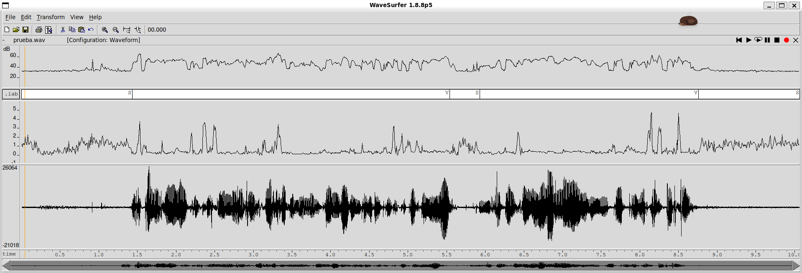
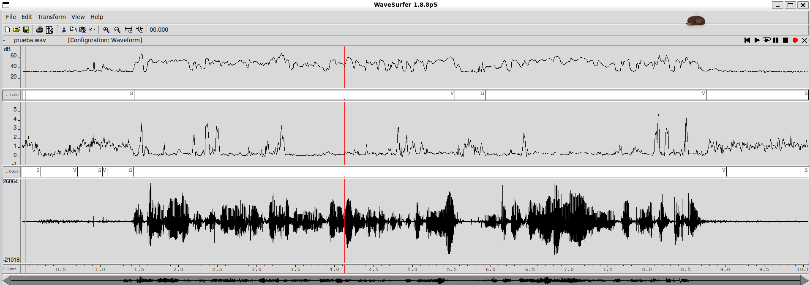
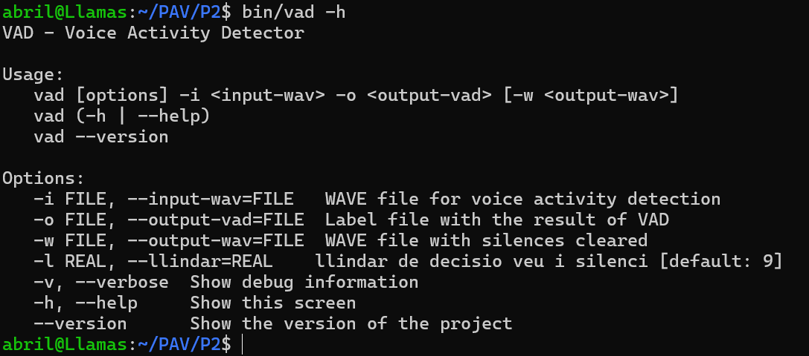

Abril Llamas Fenoll i Enxin Lina Wu
===================================
# Abril Llamas Fenoll i Enxin Lina Wu

PAV - P2: detección de actividad vocal (VAD)
============================================

Esta práctica se distribuye a través del repositorio GitHub [Práctica 2](https://github.com/albino-pav/P2),
y una parte de su gestión se realizará mediante esta web de trabajo colaborativo.  Al contrario que Git,
GitHub se gestiona completamente desde un entorno gráfico bastante intuitivo. Además, está razonablemente
documentado, tanto internamente, mediante sus [Guías de GitHub](https://guides.github.com/), como
externamente, mediante infinidad de tutoriales, guías y vídeos disponibles gratuitamente en internet.


Inicialización del repositorio de la práctica.
----------------------------------------------

Para cargar los ficheros en su ordenador personal debe seguir los pasos siguientes:

*  Abra una cuenta GitHub para gestionar esta y el resto de prácticas del curso.
*  Cree un repositorio GitHub con el contenido inicial de la práctica (sólo debe hacerlo uno de los
  integrantes del grupo de laboratorio, cuya página GitHub actuará de repositorio central del grupo):
  -  Acceda la página de la [Práctica 2](https://github.com/albino-pav/P2).
  -  En la parte superior derecha encontrará el botón **`Fork`**. Apriételo y, después de unos segundos,
    se creará en su cuenta GitHub un proyecto con el mismo nombre (**P2**). Si ya tuviera uno con ese 
    nombre, se utilizará el nombre **P2-1**, y así sucesivamente.
*  Habilite al resto de miembros del grupo como *colaboradores* del proyecto; de este modo, podrán
  subir sus modificaciones al repositorio central:
  -  En la página principal del repositorio, en la pestaña **:gear:`Settings`**, escoja la opción 
    **Collaborators** y añada a su compañero de prácticas.
  -  Éste recibirá un email solicitándole confirmación. Una vez confirmado, tanto él como el
    propietario podrán gestionar el repositorio, por ejemplo: crear ramas en él o subir las
    modificaciones de su directorio local de trabajo al repositorio GitHub.
*  En la página principal del repositorio, localice el botón **Branch: master** y úselo para crear
  una rama nueva con los primeros apellidos de los integrantes del equipo de prácticas separados por
  guion (**fulano-mengano**).
*  Todos los miembros del grupo deben realizar su copia local en su ordenador personal.
  -  Copie la dirección de su copia del repositorio apretando en el botón **Clone or download**.
    Asegúrese de usar *Clone with HTTPS*.
  -  Abra una sesión de Bash en su ordenador personal y vaya al directorio **PAV**. Desde ahí, ejecute:

    ```.sh
    git clone dirección-del-fork-de-la-práctica
    ```

  -  Vaya al directorio de la práctica `cd P2`.

  -  Cambie a la rama **fulano-mengano** con la orden:

    ```.sh
    git checkout fulano-mengano
    ```

*  A partir de este momento, todos los miembros del grupo de prácticas pueden trabajar en su directorio
  local del modo habitual, usando el repositorio remoto en GitHub como repositorio central para el trabajo colaborativo
  de los distintos miembros del grupo de prácticas o como copia de seguridad.
  -  Puede *confirmar* versiones del proyecto en su directorio local con las órdenes siguientes:

    ```.sh
    git add .
    git commit -m "Mensaje del commit"
    ```

  -  Las versiones confirmadas, y sólo ellas, se almacenan en el repositorio y pueden ser accedidas en cualquier momento.

*  Para interactuar con el contenido remoto en GitHub es necesario que los cambios en el directorio local estén confirmados.

  -  Puede comprobar si el directorio está *limpio* (es decir, si la versión actual está confirmada) usando el comando
    `git status`.

  -  La versión actual del directorio local se sube al repositorio remoto con la orden:

    ```.sh
    git push
    ```

    *  Si el repositorio remoto contiene cambios no presentes en el directorio local, `git` puede negarse
      a subir el nuevo contenido.

      -  En ese caso, lo primero que deberemos hacer es incorporar los cambios presentes en el repositorio
        GitHub con la orden `git pull`.

      -  Es posible que, al hacer el `git pull` aparezcan *conflictos*; es decir, ficheros que se han modificado
        tanto en el directorio local como en el repositorio GitHub y que `git` no sabe cómo combinar.

      -  Los conflictos aparecen marcados con cadenas del estilo `>>>>`, `<<<<` y `====`. Los ficheros correspondientes
        deben ser editados para decidir qué versión preferimos conservar. Un editor avanzado, del estilo de Microsoft
        Visual Studio Code, puede resultar muy útil para localizar los conflictos y resolverlos.

      -  Tras resolver los conflictos, se ha de confirmar los cambios con `git commit` y ya estaremos en condiciones
        de subir la nueva versión a GitHub con el comando `git push`.


  -  Para bajar al directorio local el contenido del repositorio GitHub hay que ejecutar la orden:

    ```.sh
    git pull
    ```
  
    *  Si el repositorio local contiene cambios no presentes en el directorio remoto, `git` puede negarse a bajar
      el contenido de este último.

      -  La resolución de los posibles conflictos se realiza como se explica más arriba para
        la subida del contenido local con el comando `git push`.


*  Al final de la práctica, la rama **fulano-mengano** del repositorio GitHub servirá para remitir la
  práctica para su evaluación utilizando el mecanismo *pull request*.
  -  Vaya a la página principal de la copia del repositorio y asegúrese de estar en la rama
    **fulano-mengano**.
  -  Pulse en el botón **New pull request**, y siga las instrucciones de GitHub.


Entrega de la práctica.
-----------------------

Responda, en este mismo documento (README.md), los ejercicios indicados a continuación. Este documento es
un fichero de texto escrito con un formato denominado _**markdown**_. La principal característica de este
formato es que, manteniendo la legibilidad cuando se visualiza con herramientas en modo texto (`more`,
`less`, editores varios, ...), permite amplias posibilidades de visualización con formato en una amplia
gama de aplicaciones; muy notablemente, **GitHub**, **Doxygen** y **Facebook** (ciertamente, :eyes:).

En GitHub. cuando existe un fichero denominado README.md en el directorio raíz de un repositorio, se
interpreta y muestra al entrar en el repositorio.

Debe redactar las respuestas a los ejercicios usando Markdown. Puede encontrar información acerca de su
sintáxis en la página web [Sintaxis de Markdown](https://daringfireball.net/projects/markdown/syntax).
También puede consultar el documento adjunto [MARKDOWN.md](MARKDOWN.md), en el que se enumeran los
elementos más relevantes para completar la redacción de esta práctica.

Recuerde realizar el *pull request* una vez completada la práctica.

Ejercicios
----------

### Etiquetado manual de los segmentos de voz y silencio

- Hem gravat la senyal `prueba.wav` (mono, 16 kHz, PCM lineal de 16 bits, 10 s) amb dos segments de veu separats per una pausa curta.

- Etiquetatge manual (`prueba.lab`) i captura de `wavesurfer` amb la senyal temporal, el contorn de potència, la tasa de cruces per zero i les etiquetes:

  

- A la vista de la gràfica:

  * **Increment de potència.** El silenci inicial té una potència d'uns -48 dB, i els segments de veu en tenen una mitjana d'uns -22 dB, és a dir, uns 25 dB més. (Aquests valors són els que calcula la nostra funció `compute_power()` amb la senyal normalitzada a ±1. A la captura, `wavesurfer` fa servir una altra referència i mostra el silenci al voltant de 30 dB i la veu al voltant de 50 dB, però la diferència entre tots dos és pràcticament la mateixa, de 20 a 25 dB.) Considerem que un increment d'uns **9 dB** respecte al silenci inicial ja assegura que el segment és veu. Per tornar a silenci fem servir un llindar més baix, de **3 dB** per sobre del soroll (histèresi), perquè els finals de paraula tenen menys energia.

  * **Durada mínima.** Els segments de silenci dins d'una frase (pauses entre paraules, oclusives) poden durar menys de 100 ms i no s'han de considerar silenci. Per això fixem una durada mínima de silenci de **150 ms**. Per a la veu, qualsevol síl·laba dura més de **40 ms**, de manera que els pics d'energia més curts els tractem com a soroll.

  * **Tasa de cruces per zero.** Als silencis la ZCR és alta (entre 850 i 1150 cruces/s) perquè el soroll de fons és semblant a soroll blanc. Als segments de veu sonora és molt més baixa (unes 300–350 cruces/s). Puja puntualment a les consonants fricatives sordes (/s/, /f/), que tenen poca energia però molta ZCR. Per tant, la ZCR podria ajudar a no perdre aquestes fricatives als límits dels segments de veu, tot i que el nostre detector només fa servir la potència.


### Desarrollo del detector de actividad vocal

- **Detector implementat.** És un autòmat d'estats finits (`src/vad.c`) amb sis estats: `INIT`, `SILENCE`, `VOICE`, `MAYBE_VOICE`, `MAYBE_SILENCE` i `UNDEF`.
  * `INIT`: estima el nivell de soroll `k0` com la mitjana (en escala lineal) de la potència de les 10 primeres trames (100 ms).
  * `SILENCE → MAYBE_VOICE`: quan la potència supera `k1 = k0 + 9 dB` (paràmetre `-l`, per defecte 9).
  * `MAYBE_VOICE → VOICE`: si es manté per sobre de `k2 = k0 + 3 dB` durant 4 trames (40 ms). Si no, torna a `SILENCE`.
  * `VOICE → MAYBE_SILENCE`: quan la potència baixa per sota de `k2`.
  * `MAYBE_SILENCE → SILENCE`: si es manté per sota de `k1` durant 15 trames (150 ms). Si torna a superar `k1`, torna a `VOICE`.
  * Els estats dubtosos retornen `UNDEF`, i `main_vad.c` els assigna a l'estat anterior o al nou estat (situant el canvi a l'inici del tram dubtós). Així el fitxer `.vad` només conté etiquetes `S` i `V`.
  * Els paràmetres s'han ajustat buscant el màxim de la puntuació F `TOTAL` sobre `db.v4`.

- Senyal temporal, etiquetatge manual i detecció automàtica del fitxer gravat:

  

- **Discrepàncies entre l'etiquetatge manual i la detecció automàtica** (F-score del 92,8% sobre la nostra senyal):
  * Entre 0,24 i 0,71 s (i breument entre 1,03 i 1,09 s) el detector marca veu on nosaltres hem etiquetat silenci. En aquest tram hi ha un soroll (probablement una respiració) amb una potència de fins a -30 dB, molt per sobre del soroll de fons. Té una ZCR baixa, semblant a la de la veu, i per això el detector no el pot distingir només amb la potència.
  * La pausa entre 5,54 i 5,93 s no es detecta. Dins de la pausa hi ha pics de potència de -32 a -35 dB (soroll o respiració) que superen el llindar `k1` i fan tornar l'autòmat a veu abans de completar els 150 ms de silenci.
  * El final de la veu es detecta a 9,02 s, mentre que l'etiquetatge manual el situa a 8,76 s. La cua de la última paraula queda per sobre de `k2` una mica més del que hem etiquetat a mà.

- **Avaluació sobre `db.v4`** amb `vad_evaluation.pl` (resum):

  ```
  Recall V:610.14/625.02 97.62%   Precision V:610.14/656.10 92.99%   F-score V (2)  : 96.66%
  Recall S:354.50/400.47 88.52%   Precision S:354.50/369.38 95.97%   F-score S (1/2): 94.38%
  ===> TOTAL: 95.514%
  ```


### Trabajos de ampliación

#### Gestión de las opciones del programa usando `docopt_c`

- Hem afegit l'opció `-l` / `--llindar` per indicar el llindar d'entrada a veu (dB per sobre del soroll). Missatge d'ajuda del programa:

  


### Contribuciones adicionales y/o comentarios acerca de la práctica

- Hem fet servir dos llindars amb histèresi (`k1` per entrar a veu i `k2` per sortir-ne) i hem estimat el soroll amb la mitjana de diverses trames inicials en comptes d'una sola, cosa que fa el detector més robust.
- Hem fet un script (`cardem-li`) per escombrar valors del llindar i trobar el que maximitza la puntuació `TOTAL`.


### Antes de entregar la práctica

Recuerde comprobar que el repositorio cuenta con los códigos correctos y en condiciones de ser 
correctamente compilados con la orden `meson bin; ninja -C bin`. El programa generado (`bin/vad`) será
el usado, sin más opciones, para realizar la evaluación *ciega* del sistema.
