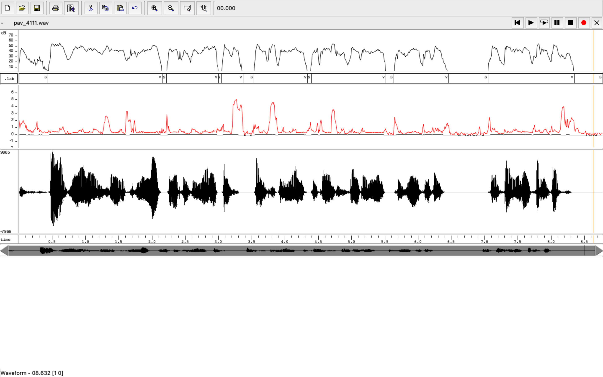
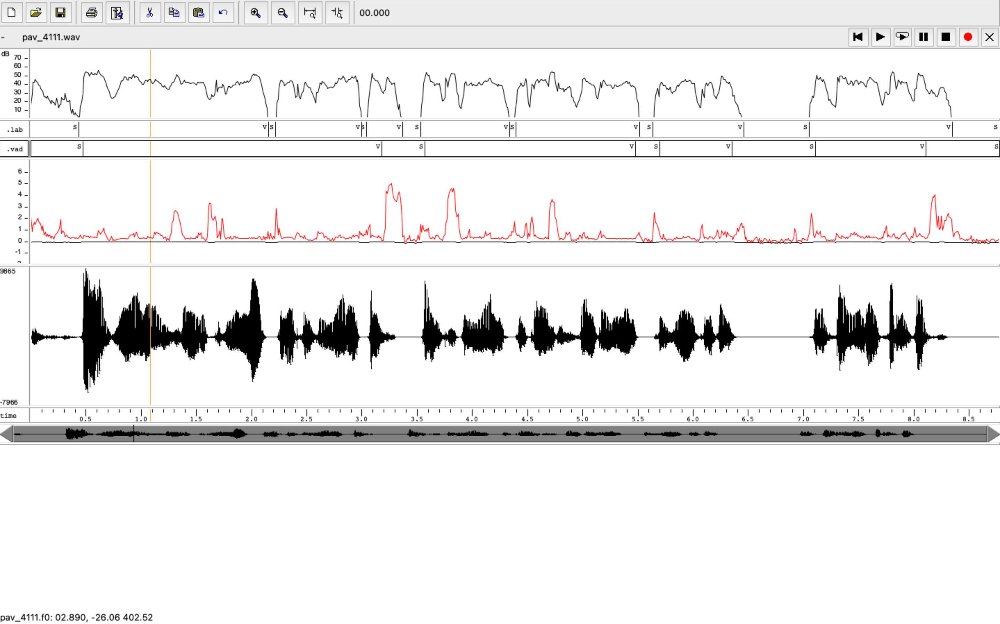
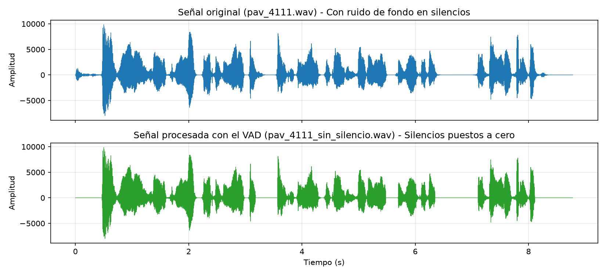

Alex Galvan Paredes y Alex Fernandez
==================================

PAV - P2: detección de actividad vocal (VAD)
============================================

Esta práctica se distribuye a través del repositorio GitHub [Práctica 2](https://github.com/albino-pav/P2),
y una parte de su gestión se realizará mediante esta web de trabajo colaborativo.  Al contrario que Git,
GitHub se gestiona completamente desde un entorno gráfico bastante intuitivo. Además, está razonablemente
documentado, tanto internamente, mediante sus [Guías de GitHub](https://guides.github.com/), como
externamente, mediante infinidad de tutoriales, guías y vídeos disponibles gratuitamente en internet.


Inicialización del repositorio de la práctica.
----------------------------------------------

Para cargar los ficheros en su ordenador personal debe seguir los pasos siguientes:

*  Abra una cuenta GitHub para gestionar esta y el resto de prácticas del curso.
*  Cree un repositorio GitHub con el contenido inicial de la práctica (sólo debe hacerlo uno de los
  integrantes del grupo de laboratorio, cuya página GitHub actuará de repositorio central del grupo):
  -  Acceda la página de la [Práctica 2](https://github.com/albino-pav/P2).
  -  En la parte superior derecha encontrará el botón **`Fork`**. Apriételo y, después de unos segundos,
    se creará en su cuenta GitHub un proyecto con el mismo nombre (**P2**). Si ya tuviera uno con ese 
    nombre, se utilizará el nombre **P2-1**, y así sucesivamente.
*  Habilite al resto de miembros del grupo como *colaboradores* del proyecto; de este modo, podrán
  subir sus modificaciones al repositorio central:
  -  En la página principal del repositorio, en la pestaña **:gear:`Settings`**, escoja la opción 
    **Collaborators** y añada a su compañero de prácticas.
  -  Éste recibirá un email solicitándole confirmación. Una vez confirmado, tanto él como el
    propietario podrán gestionar el repositorio, por ejemplo: crear ramas en él o subir las
    modificaciones de su directorio local de trabajo al repositorio GitHub.
*  En la página principal del repositorio, localice el botón **Branch: master** y úselo para crear
  una rama nueva con los primeros apellidos de los integrantes del equipo de prácticas separados por
  guion (**fulano-mengano**).
*  Todos los miembros del grupo deben realizar su copia local en su ordenador personal.
  -  Copie la dirección de su copia del repositorio apretando en el botón **Clone or download**.
    Asegúrese de usar *Clone with HTTPS*.
  -  Abra una sesión de Bash en su ordenador personal y vaya al directorio **PAV**. Desde ahí, ejecute:

    ```.sh
    git clone dirección-del-fork-de-la-práctica
    ```

  -  Vaya al directorio de la práctica `cd P2`.

  -  Cambie a la rama **fulano-mengano** con la orden:

    ```.sh
    git checkout fulano-mengano
    ```

*  A partir de este momento, todos los miembros del grupo de prácticas pueden trabajar en su directorio
  local del modo habitual, usando el repositorio remoto en GitHub como repositorio central para el trabajo colaborativo
  de los distintos miembros del grupo de prácticas o como copia de seguridad.
  -  Puede *confirmar* versiones del proyecto en su directorio local con las órdenes siguientes:

    ```.sh
    git add .
    git commit -m "Mensaje del commit"
    ```

  -  Las versiones confirmadas, y sólo ellas, se almacenan en el repositorio y pueden ser accedidas en cualquier momento.

*  Para interactuar con el contenido remoto en GitHub es necesario que los cambios en el directorio local estén confirmados.

  -  Puede comprobar si el directorio está *limpio* (es decir, si la versión actual está confirmada) usando el comando
    `git status`.

  -  La versión actual del directorio local se sube al repositorio remoto con la orden:

    ```.sh
    git push
    ```

    *  Si el repositorio remoto contiene cambios no presentes en el directorio local, `git` puede negarse
      a subir el nuevo contenido.

      -  En ese caso, lo primero que deberemos hacer es incorporar los cambios presentes en el repositorio
        GitHub con la orden `git pull`.

      -  Es posible que, al hacer el `git pull` aparezcan *conflictos*; es decir, ficheros que se han modificado
        tanto en el directorio local como en el repositorio GitHub y que `git` no sabe cómo combinar.

      -  Los conflictos aparecen marcados con cadenas del estilo `>>>>`, `<<<<` y `====`. Los ficheros correspondientes
        deben ser editados para decidir qué versión preferimos conservar. Un editor avanzado, del estilo de Microsoft
        Visual Studio Code, puede resultar muy útil para localizar los conflictos y resolverlos.

      -  Tras resolver los conflictos, se ha de confirmar los cambios con `git commit` y ya estaremos en condiciones
        de subir la nueva versión a GitHub con el comando `git push`.


  -  Para bajar al directorio local el contenido del repositorio GitHub hay que ejecutar la orden:

    ```.sh
    git pull
    ```
  
    *  Si el repositorio local contiene cambios no presentes en el directorio remoto, `git` puede negarse a bajar
      el contenido de este último.

      -  La resolución de los posibles conflictos se realiza como se explica más arriba para
        la subida del contenido local con el comando `git push`.


*  Al final de la práctica, la rama **fulano-mengano** del repositorio GitHub servirá para remitir la
  práctica para su evaluación utilizando el mecanismo *pull request*.
  -  Vaya a la página principal de la copia del repositorio y asegúrese de estar en la rama
    **fulano-mengano**.
  -  Pulse en el botón **New pull request**, y siga las instrucciones de GitHub.


Entrega de la práctica.
-----------------------

Responda, en este mismo documento (README.md), los ejercicios indicados a continuación. Este documento es
un fichero de texto escrito con un formato denominado _**markdown**_. La principal característica de este
formato es que, manteniendo la legibilidad cuando se visualiza con herramientas en modo texto (`more`,
`less`, editores varios, ...), permite amplias posibilidades de visualización con formato en una amplia
gama de aplicaciones; muy notablemente, **GitHub**, **Doxygen** y **Facebook** (ciertamente, :eyes:).

En GitHub. cuando existe un fichero denominado README.md en el directorio raíz de un repositorio, se
interpreta y muestra al entrar en el repositorio.

Debe redactar las respuestas a los ejercicios usando Markdown. Puede encontrar información acerca de su
sintáxis en la página web [Sintaxis de Markdown](https://daringfireball.net/projects/markdown/syntax).
También puede consultar el documento adjunto [MARKDOWN.md](MARKDOWN.md), en el que se enumeran los
elementos más relevantes para completar la redacción de esta práctica.

Recuerde realizar el *pull request* una vez completada la práctica.

Ejercicios
----------

### Etiquetado manual de los segmentos de voz y silencio

- Grabe una señal de voz en la que haya distintos segmentos de voz y silencio. La señal debe ser de un
  solo canal (monofónica), grabada con una frecuencia de muestreo de 16 kHz y codificada con PCM lineal
  de 16 bits.

  Nombre a la señal como `pav_GGP#.wav`, donde GG es el grupo de clase (por ejemplo, 21 o 41), P es el
  número del puesto de trabajo y # es el número de señal (si sólo se entrega una señal, este número es
  1).

  > NOTA: es habitual que las grabaciones empiecen con un segmento de silencio de potencia extremadamente
  > bajo; mucho más bajo que el nivel de ruido normal durante el resto de la señal. Si esto ocurre, la
  > detección usando como nivel de referencia para el silencio el segmento inicial se ve seriamente
  > dificultada. Puede detectar esta situación visualizando el nivel de potencia estimado por el propio
  > `wavesurfer` y corregirla usando la herramienta de corte (:scissors:).

  > **Nota sobre nuestra señal (`pav_4111.wav`):** Se ha utilizado la grabación monofónica a 16 kHz y 16 bits realizada para la practica 1. Siguiendo la indicación del enunciado, se ha inspeccionado el inicio de la grabación en `wavesurfer` y se ha recortado el primer medio segundo de señal, ya que presentaba una potencia artificialmente nula que habría distorsionado la estimación del nivel de ruido de fondo en el estado inicial (`ST_INIT`). Además, se ha extraído la tasa de cruces por cero (ZCR) mediante la función `compute_zcr` implementada en `pav_analysis.c` para visualizarla junto a la forma de onda y el contorno de potencia.

- Etiquete manualmente los segmentos de voz y silencio del fichero grabado al efecto. Inserte, a
  continuación, una captura de `wavesurfer` en la que se vea con claridad la señal temporal, el contorno de
  potencia y la tasa de cruces por cero, junto con el etiquetado manual de los segmentos.



- A la vista de la gráfica, indique qué valores considera adecuados para las magnitudes siguientes:

  * Incremento del nivel potencia en dB, respecto al nivel correspondiente al silencio inicial, para
    estar seguros de que un segmento de señal se corresponde con voz.

    >Observando el panel superior de potencia en `wavesurfer`, durante los segmentos de silencio (por ejemplo, entre `6.46 s` y `7.05 s`, o justo antes del inicio de la locución en `0.43 s`), el nivel de ruido de fondo se sitúa en torno a los **5 - 10 dB** (nivel de referencia $k_0$). En cambio, durante los segmentos de voz (`V`), la potencia sube rápidamente situándose entre **30 dB y 55 dB**.
    >* Para detectar sonidos débiles al inicio o final de palabra (como las consonantes fricativas sordas `/s/`, `/z/` o `/f/`), basta con un primer umbral de sospecha ($k_1 = k_0 + \alpha_1$) de unos **3 dB a 6 dB** por encima del ruido de fondo.
    >* Para estar completamente seguros de que el segmento corresponde a voz (vocales y consonantes sonoras), un incremento de entre **8 dB y 12 dB** sobre el nivel de silencio inicial ($k_2 = k_0 + \alpha_2$) permite discriminar la voz del ruido ambiente sin ambigüedad.

  * Duración mínima razonable de los segmentos de voz y silencio.

  >* **Duración mínima de silencio:** En nuestro etiquetado manual (`pav_4111.lab`), las pausas reales más breves entre sintagmas duran entre **60 ms y 160 ms** (por ejemplo, `2.15 s - 2.21 s` con ~63 ms, o `5.51 s - 5.63 s` con ~120 ms), mientras que las pausas respiratorias claras superan los **400 - 600 ms** (`0.00 s - 0.43 s` y `6.46 s - 7.05 s`). Por otro lado, dentro de un mismo segmento de voz existen breves caídas de potencia (oclusiones previas a `/p/`, `/t/`, `/k/`, como en *"compañero"* o *"planta"*) que duran entre 30 ms y 80 ms. Por tanto, una duración mínima razonable para confirmar un segmento de silencio en el detector automático se sitúa entre **150 ms y 220 ms** (15 a 22 tramas de 10 ms), evitando así trocear palabras.
  >* **Duración mínima de voz:** Los segmentos de voz reales en la señal superan holgadamente los **300 ms** (el más corto, correspondiente a la palabra *"es"* entre `3.04 s` y `3.37 s`, dura **327 ms**). Fijar una duración mínima de voz de entre **80 ms y 100 ms** (8 a 10 tramas de 10 ms) resulta idóneo para descartar ruidos transitorios o chasquidos de corta duración sin perder sílabas breves.

  * ¿Es capaz de sacar alguna conclusión a partir de la evolución de la tasa de cruces por cero?

  >Analizando la curva roja (panel central de ZCR) en nuestra señal `pav_4111.wav`, se observa claramente cómo responde a la naturaleza acústica de cada fonema:
    >1. **Sonidos fricativos sordos (`/s/`, `/z/`, `/f/`):** Presentan picos muy pronunciados en la ZCR (alcanzando entre 3000 y 5000 cruces/s) mientras su potencia cae respecto a las vocales. Se observa con total nitidez en el instante `3.20 s - 3.37 s` (la `/s/` final de *"es"*), en `3.80 s` (la `/s/` de *"Alex"*), en `4.45 s` (*"estamos"*) o en `8.20 s` (*"Ferraté"*). Sin la ZCR o un umbral bajo $k_1$, estas colas fricativas podrían confundirse fácilmente con silencio.
    >2. **Sonidos sonoros (vocales y nasales):** Concentran su energía en bajas frecuencias (frecuencia fundamental y primeros formantes), por lo que muestran una **potencia muy alta** pero una **ZCR muy baja y estable**.
    >3. **Segmentos de silencio (`S`):** Presentan una potencia mínima acompañada de una ZCR baja-media e irregular propia del ruido térmico y ambiental de la sala.


### Desarrollo del detector de actividad vocal

- Complete el código de los ficheros de la práctica para implementar un detector de actividad vocal en
  tiempo real tan exacto como sea posible. Tome como objetivo la maximización de la puntuación-F `TOTAL`.
>Para maximizar la puntuación $F_{mix}$ sobre la base de datos, se ha diseñado e implementado en `vad.c`, `vad.h` y `main_vad.c` un **Autómata de Estados Finitos (FSA)** de 5 estados con decisión diferida e histéresis de doble umbral:
  >1. **`ST_INIT` (Estimación del ruido de fondo):** Durante las primeras $N_{init} = 10$ tramas ($100\text{ ms}$), se calcula la media lineal de la potencia de cada trama y se convierte a decibelios ($k_0 = 10\log_{10}(\frac{1}{N_{init}}\sum 10^{P_{dB}[i]/10})$). A partir de $k_0$, se fijan dinámicamente dos umbrales adaptados al nivel de grabación de cada señal: un umbral inferior de sospecha de voz $k_1 = k_0 + \alpha_1$ (con $\alpha_1 = 5.5\text{ dB}$) y un umbral superior de confirmación $k_2 = k_1 + \alpha_2$ (con $\alpha_2 = 2.5\text{ dB}$).
  >2. **`ST_SILENCE`:** Permanece en silencio mientras $P_{dB}[i] \le k_1$. Si supera $k_1$, transita al estado provisional `ST_MAYBE_VOICE`.
  >3. **`ST_MAYBE_VOICE` (Decisión diferida de inicio de voz):** Devuelve `ST_UNDEF` al programa principal mientras evalúa si la subida de potencia es voz real o un ruido impulsivo. Para confirmar la transición a `ST_VOICE`, exige que la potencia se mantenga por encima de $k_1$ durante al menos `min_voice = 8` tramas ($80\text{ ms}$) y que en algún instante alcance el umbral superior $k_2$. Si no supera $k_1$ o transcurren más de $250\text{ ms}$ sin alcanzar $k_2$, regresa a `ST_SILENCE` descartando el falso positivo.
  >4. **`ST_VOICE`:** Permanece en voz mientras $P_{dB}[i] > k_1$. Cuando cae por debajo de $k_1$, pasa al estado provisional `ST_MAYBE_SILENCE`.
  >5. **`ST_MAYBE_SILENCE` (Decisión diferida de fin de voz):** Devuelve `ST_UNDEF` mientras comprueba si la caída de potencia es una pausa real o una breve oclusión intrapalabra. Solo si se acumulan `min_silence = 21` tramas consecutivas ($210\text{ ms}$) con $P_{dB}[i] \le k_1$ se confirma el paso a `ST_SILENCE` (retrotrayendo el inicio del silencio al instante en que entró en `ST_MAYBE_SILENCE`). Si la potencia vuelve a superar $k_1$ antes de ese tiempo, se mantiene el estado `ST_VOICE`.

- Inserte una gráfica en la que se vea con claridad la señal temporal, el etiquetado manual y la detección
  automática conseguida para el fichero grabado al efecto.

   

- Explique, si existen. las discrepancias entre el etiquetado manual y la detección automática.

>Al evaluar el detector automático sobre nuestra señal de prueba (`pav_4111.lab`), se obtiene un **Recall de voz del 88.82%**, una **Precisión de voz del 97.39%** ($F_2(V) = 90.41\%$) y un **Recall de silencio del 91.39%**. Al comparar visualmente los paneles `.lab` y `.vad` en `wavesurfer`, las pequeñas discrepancias observadas se deben a dos motivos fundamentales:
  >1. **Fusión de micropausas inferiores a la duración mínima de silencio (`210 ms`):** En el etiquetado manual (`.lab`) se marcaron como silencios breves algunas pausas interléxicas muy cortas, de entre $60\text{ ms}$ y $120\text{ ms}$ (por ejemplo, en `2.15 s - 2.21 s`, `3.00 s - 3.04 s` o `4.34 s - 4.39 s`). Dado que el autómata exige un mínimo de `min_silence = 21` tramas ($210\text{ ms}$) para confirmar un silencio y no trocear consonantes oclusivas en el conjunto de la base de datos, el detector mantiene esos breves intervalos dentro del bloque de voz (`V`), reduciendo ligeramente la precisión de silencio en este fichero particular a cambio de proteger el *Recall* de voz.
  >2. **Suavizado en las colas finales de fonemas débiles:** En los finales de frase donde la energía decae de forma muy progresiva hasta fundirse con el ruido ambiente de la biblioteca, el umbral $k_1 = k_0 + 5.5\text{ dB}$ corta unas pocas tramas antes o después respecto al criterio subjetivo humano.

- Evalúe los resultados sobre la base de datos `db.v4` con el script `vad_evaluation.pl` e inserte a 
  continuación las tasas de sensibilidad (*recall*) y precisión para el conjunto de la base de datos (sólo
  el resumen).

  >Ejecutando `scripts/run_vad.sh` sobre la totalidad de ficheros de la base de datos `db.v4`, el resumen global (`Summary`) obtenido con `vad_evaluation.pl` es el siguiente:

  >```text
  >**************** Summary ****************
  >Recall V:613.20/625.02 98.11%   Precision V:613.20/675.68 90.75%   F-score V (2)  : 96.54%
  >Recall S:337.98/400.47 84.40%   Precision S:337.98/349.80 96.62%   F-score S (1/2): 93.90%
  >===> TOTAL: 95.213%


### Trabajos de ampliación

#### Cancelación del ruido en los segmentos de silencio

- Si ha desarrollado el algoritmo para la cancelación de los segmentos de silencio, inserte una gráfica en
  la que se vea con claridad la señal antes y después de la cancelación (puede que `wavesurfer` no sea la
  mejor opción para esto, ya que no es capaz de visualizar varias señales al mismo tiempo).

>Se ha implementado en `src/main_vad.c` la escritura del fichero de audio de salida (`-w` / `--output-wav`) empleando las funciones de la librería `libsndfile`. A medida que se leen las tramas de entrada, se copian en `sndfile_out` mediante `sf_write_float()`. Dado que el autómata utiliza decisión diferida (`ST_UNDEF`) durante las transiciones `ST_MAYBE_SILENCE` y `ST_MAYBE_VOICE`, cuando finalmente se confirma que un tramo corresponde a `ST_SILENCE`, el programa retrocede en el fichero de audio de salida hasta el inicio real del silencio (`undef_t * frame_size`) usando `sf_seek(sndfile_out, undef_t * frame_size, SEEK_SET)` y sobrescribe todas las tramas del intervalo con el vector de ceros `buffer_zeros`.

  

  >Como se aprecia en la gráfica comparativa superior (señal original `pav_4111.wav`) e inferior (señal procesada `pav_4111_sin_silencio.wav`), las fluctuaciones de ruido de fondo presentes en el silencio inicial (`0.00 - 0.43 s`), en las pausas intermedias y en el tramo final (`8.35 - 8.78 s`) quedan completamente anuladas a amplitud cero, preservando intactos los segmentos de actividad vocal.
#### Gestión de las opciones del programa usando `docopt_c`

- Si ha usado `docopt_c` para realizar la gestión de las opciones y argumentos del programa `vad`, inserte
  una captura de pantalla en la que se vea el mensaje de ayuda del programa.

>Se ha modificado el fichero `src/vad.docopt` y regenerado la cabecera `src/vad_docopt.h` mediante `docopt_c.py` para permitir configurar desde la línea de comandos todos los hiperparámetros del autómata sin necesidad de recompilar el código C:
  >* `-l REAL, --llindar=REAL`: Margen principal $\alpha_1$ en dB sobre el nivel de ruido $k_0$ (`[default: 5.5]`).
  >* `-2 REAL, --alpha2=REAL`: Margen adicional de confirmación $\alpha_2$ en dB para el segundo umbral $k_2 = k_1 + \alpha_2$ (`[default: 2.5]`).
 > * `-m INT, --min-voice=INT`: Número mínimo de tramas para confirmar el estado de voz (`[default: 8]`, equivalente a $80\text{ ms}$).
  >* `-s INT, --min-silence=INT`: Número mínimo de tramas para confirmar el estado de silencio (`[default: 21]`, equivalente a $210\text{ ms}$).
  >* `-n INT, --n-init=INT`: Número de tramas iniciales empleadas en `ST_INIT` para estimar la potencia del ruido de fondo (`[default: 10]`, equivalente a $100\text{ ms}$).

  

### Contribuciones adicionales y/o comentarios acerca de la práctica

- Indique a continuación si ha realizado algún tipo de aportación suplementaria (algoritmos de detección o 
  parámetros alternativos, etc.).

>1. **Estimación robusta del nivel de ruido en el dominio lineal (`ST_INIT`):** En lugar de promediar directamente los valores en decibelios (media geométrica, muy sensible a tramas atípicas de potencia casi nula), se ha implementado la media aritmética de la potencia lineal durante las primeras $N_{init} = 10$ tramas ($100\text{ ms}$) antes de pasar a dB: $k_0 = 10\log_{10}(\frac{1}{N_{init}}\sum 10^{P_{dB}[i]/10})$.
  >2. **Mecanismo de histéresis con doble umbral ($k_1, k_2$) y tiempo máximo de espera (`max_maybe_v`):** Se ha incorporado un límite temporal máximo de permanencia en el estado `ST_MAYBE_VOICE` ($250\text{ ms}$) para aquellos segmentos cuya potencia supera levemente $k_1$ pero nunca alcanza el umbral de confirmación de voz $k_2$. De este modo, si se produce una fluctuación estacionaria del ruido de fondo por encima de $k_1$, el autómata la descarta y retorna a `ST_SILENCE` en lugar de quedarse indefinidamente en `ST_UNDEF`.
  >3. **Automatización del barrido de parámetros en Bash (`cardem-li` y `run_vad.sh`):** Aprovechando la integración con `docopt_c`, se ha utilizado el script en Bash para realizar búsquedas en (*grid search*) sobre la base de datos `db.v4`, encontrando el punto óptimo de operación ($\alpha_1 = 5.5\text{ dB}$, $\alpha_2 = 2.5\text{ dB}$, $T_{min,V} = 80\text{ ms}$, $T_{min,S} = 210\text{ ms}$), que alcanza un **TOTAL de 95.213%**.
  >4. **Extracción combinada de características para `wavesurfer`:** Se ha modificado `vad_show_state()` para exportar simultáneamente la potencia en dB y la tasa de cruces por cero (ZCR) con la opción `-v`, facilitando su representación directa mediante *Data Plots* en `wavesurfer`.

- Si lo desea, puede realizar también algún comentario acerca de la realización de la práctica que
  considere de interés de cara a su evaluación.
>La práctica ha permitido comprobar de forma práctica cómo un detector basado exclusivamente en un umbral estático frame a frame resulta insuficiente frente a fenómenos naturales del habla (como las oclusiones sordas intrapalabra o las fricativas débiles en los extremos de frase). La introducción de un autómata de estados finitos con decisión diferida (`ST_MAYBE_VOICE` y `ST_MAYBE_SILENCE`) y la ponderación asimétrica de la métrica $F_\beta$ ($\beta = 2$ para priorizar la sensibilidad en voz y $\beta = 1/2$ para priorizar la precisión en silencio) resultan determinantes para superar el 95% de acierto global sin recortar información hablada.

### Antes de entregar la práctica

Recuerde comprobar que el repositorio cuenta con los códigos correctos y en condiciones de ser 
correctamente compilados con la orden `meson bin; ninja -C bin`. El programa generado (`bin/vad`) será
el usado, sin más opciones, para realizar la evaluación *ciega* del sistema.
