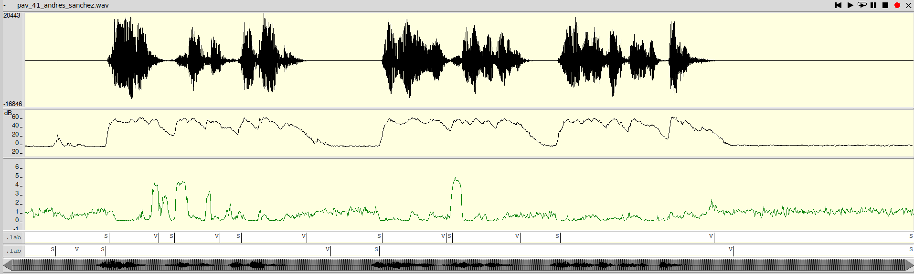
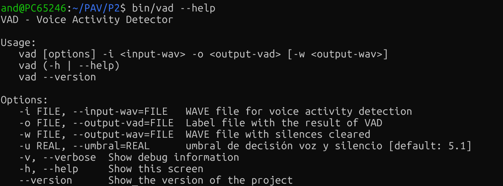

# Andrés Sánchez Alcántara


PAV - P2: detección de actividad vocal (VAD)
============================================

Esta práctica se distribuye a través del repositorio GitHub [Práctica 2](https://github.com/albino-pav/P2),
y una parte de su gestión se realizará mediante esta web de trabajo colaborativo.  Al contrario que Git,
GitHub se gestiona completamente desde un entorno gráfico bastante intuitivo. Además, está razonablemente
documentado, tanto internamente, mediante sus [Guías de GitHub](https://guides.github.com/), como
externamente, mediante infinidad de tutoriales, guías y vídeos disponibles gratuitamente en internet.


Inicialización del repositorio de la práctica.
----------------------------------------------

Para cargar los ficheros en su ordenador personal debe seguir los pasos siguientes:

*  Abra una cuenta GitHub para gestionar esta y el resto de prácticas del curso.
*  Cree un repositorio GitHub con el contenido inicial de la práctica (sólo debe hacerlo uno de los
  integrantes del grupo de laboratorio, cuya página GitHub actuará de repositorio central del grupo):
  -  Acceda la página de la [Práctica 2](https://github.com/albino-pav/P2).
  -  En la parte superior derecha encontrará el botón **`Fork`**. Apriételo y, después de unos segundos,
    se creará en su cuenta GitHub un proyecto con el mismo nombre (**P2**). Si ya tuviera uno con ese 
    nombre, se utilizará el nombre **P2-1**, y así sucesivamente.
*  Habilite al resto de miembros del grupo como *colaboradores* del proyecto; de este modo, podrán
  subir sus modificaciones al repositorio central:
  -  En la página principal del repositorio, en la pestaña **:gear:`Settings`**, escoja la opción 
    **Collaborators** y añada a su compañero de prácticas.
  -  Éste recibirá un email solicitándole confirmación. Una vez confirmado, tanto él como el
    propietario podrán gestionar el repositorio, por ejemplo: crear ramas en él o subir las
    modificaciones de su directorio local de trabajo al repositorio GitHub.
*  En la página principal del repositorio, localice el botón **Branch: master** y úselo para crear
  una rama nueva con los primeros apellidos de los integrantes del equipo de prácticas separados por
  guion (**fulano-mengano**).
*  Todos los miembros del grupo deben realizar su copia local en su ordenador personal.
  -  Copie la dirección de su copia del repositorio apretando en el botón **Clone or download**.
    Asegúrese de usar *Clone with HTTPS*.
  -  Abra una sesión de Bash en su ordenador personal y vaya al directorio **PAV**. Desde ahí, ejecute:

    ```.sh
    git clone dirección-del-fork-de-la-práctica
    ```

  -  Vaya al directorio de la práctica `cd P2`.

  -  Cambie a la rama **fulano-mengano** con la orden:

    ```.sh
    git checkout fulano-mengano
    ```

*  A partir de este momento, todos los miembros del grupo de prácticas pueden trabajar en su directorio
  local del modo habitual, usando el repositorio remoto en GitHub como repositorio central para el trabajo colaborativo
  de los distintos miembros del grupo de prácticas o como copia de seguridad.
  -  Puede *confirmar* versiones del proyecto en su directorio local con las órdenes siguientes:

    ```.sh
    git add .
    git commit -m "Mensaje del commit"
    ```

  -  Las versiones confirmadas, y sólo ellas, se almacenan en el repositorio y pueden ser accedidas en cualquier momento.

*  Para interactuar con el contenido remoto en GitHub es necesario que los cambios en el directorio local estén confirmados.

  -  Puede comprobar si el directorio está *limpio* (es decir, si la versión actual está confirmada) usando el comando
    `git status`.

  -  La versión actual del directorio local se sube al repositorio remoto con la orden:

    ```.sh
    git push
    ```

    *  Si el repositorio remoto contiene cambios no presentes en el directorio local, `git` puede negarse
      a subir el nuevo contenido.

      -  En ese caso, lo primero que deberemos hacer es incorporar los cambios presentes en el repositorio
        GitHub con la orden `git pull`.

      -  Es posible que, al hacer el `git pull` aparezcan *conflictos*; es decir, ficheros que se han modificado
        tanto en el directorio local como en el repositorio GitHub y que `git` no sabe cómo combinar.

      -  Los conflictos aparecen marcados con cadenas del estilo `>>>>`, `<<<<` y `====`. Los ficheros correspondientes
        deben ser editados para decidir qué versión preferimos conservar. Un editor avanzado, del estilo de Microsoft
        Visual Studio Code, puede resultar muy útil para localizar los conflictos y resolverlos.

      -  Tras resolver los conflictos, se ha de confirmar los cambios con `git commit` y ya estaremos en condiciones
        de subir la nueva versión a GitHub con el comando `git push`.


  -  Para bajar al directorio local el contenido del repositorio GitHub hay que ejecutar la orden:

    ```.sh
    git pull
    ```
  
    *  Si el repositorio local contiene cambios no presentes en el directorio remoto, `git` puede negarse a bajar
      el contenido de este último.

      -  La resolución de los posibles conflictos se realiza como se explica más arriba para
        la subida del contenido local con el comando `git push`.


*  Al final de la práctica, la rama **fulano-mengano** del repositorio GitHub servirá para remitir la
  práctica para su evaluación utilizando el mecanismo *pull request*.
  -  Vaya a la página principal de la copia del repositorio y asegúrese de estar en la rama
    **fulano-mengano**.
  -  Pulse en el botón **New pull request**, y siga las instrucciones de GitHub.


Entrega de la práctica.
-----------------------

Responda, en este mismo documento (README.md), los ejercicios indicados a continuación. Este documento es
un fichero de texto escrito con un formato denominado _**markdown**_. La principal característica de este
formato es que, manteniendo la legibilidad cuando se visualiza con herramientas en modo texto (`more`,
`less`, editores varios, ...), permite amplias posibilidades de visualización con formato en una amplia
gama de aplicaciones; muy notablemente, **GitHub**, **Doxygen** y **Facebook** (ciertamente, :eyes:).

En GitHub. cuando existe un fichero denominado README.md en el directorio raíz de un repositorio, se
interpreta y muestra al entrar en el repositorio.

Debe redactar las respuestas a los ejercicios usando Markdown. Puede encontrar información acerca de su
sintáxis en la página web [Sintaxis de Markdown](https://daringfireball.net/projects/markdown/syntax).
También puede consultar el documento adjunto [MARKDOWN.md](MARKDOWN.md), en el que se enumeran los
elementos más relevantes para completar la redacción de esta práctica.

Recuerde realizar el *pull request* una vez completada la práctica.

Ejercicios
----------

### Etiquetado manual de los segmentos de voz y silencio

- Grabe una señal de voz en la que haya distintos segmentos de voz y silencio. La señal debe ser de un
  solo canal (monofónica), grabada con una frecuencia de muestreo de 16 kHz y codificada con PCM lineal
  de 16 bits.

  Nombre a la señal como `pav_GGP#.wav`, donde GG es el grupo de clase (por ejemplo, 21 o 41), P es el
  número del puesto de trabajo y # es el número de señal (si sólo se entrega una señal, este número es
  1).

  > NOTA: es habitual que las grabaciones empiecen con un segmento de silencio de potencia extremadamente
  > bajo; mucho más bajo que el nivel de ruido normal durante el resto de la señal. Si esto ocurre, la
  > detección usando como nivel de referencia para el silencio el segmento inicial se ve seriamente
  > dificultada. Puede detectar esta situación visualizando el nivel de potencia estimado por el propio
  > `wavesurfer` y corregirla usando la herramienta de corte (:scissors:).

- Etiquete manualmente los segmentos de voz y silencio del fichero grabado al efecto. Inserte, a
  continuación, una captura de `wavesurfer` en la que se vea con claridad la señal temporal, el contorno de
  potencia y la tasa de cruces por cero, junto con el etiquetado manual de los segmentos.

- A la vista de la gráfica, indique qué valores considera adecuados para las magnitudes siguientes:

  * Incremento del nivel potencia en dB, respecto al nivel correspondiente al silencio inicial, para
    estar seguros de que un segmento de señal se corresponde con voz.

  * Duración mínima razonable de los segmentos de voz y silencio.

  * ¿Es capaz de sacar alguna conclusión a partir de la evolución de la tasa de cruces por cero?


**Grabación y etiquetado manual**

Se ha utilizado una grabación propia en formato WAV, monofónica, con una frecuencia de muestreo de 16 kHz y codificación PCM lineal de 16 bits.

**Nota sobre la nomenclatura de los archivos**

El grupo de clase es el **41**. Debido a que no he podido confirmar mi número de puesto de laboratorio, he utilizado el identificador `pav_41_andres_sanchez` en lugar del formato `pav_GGP#` indicado en el enunciado.

Los archivos correspondientes a la grabación definitiva son:

- `pav_41_andres_sanchez.wav`: señal de voz recortada, de 9,361375 segundos.
- `pav_41_andres_sanchez.lab`: etiquetado manual de voz y silencio.
- `pav_41_andres_sanchez.vad`: etiquetado generado automáticamente por el detector.

Los tres archivos corresponden a la misma señal. Se ha incluido el grupo y el nombre del estudiante para permitir su identificación.

Al analizarla en WaveSurfer se observó que el silencio tenía una potencia demasiado baja justo en el momento inicial. Se recortó ese fragmento inicial para mejorar la estimación del nivel de referencia del silencio.

Los segmentos de voz (`V`) y silencio (`S`) se etiquetaron manualmente mediante la escucha y la observación de la forma de onda y la potencia. Las etiquetas se guardaron en `pav_41_andres_sanchez.lab`.

La siguiente captura muestra la forma de onda, la potencia, la ZCR, las etiquetas manuales y la detección automática:



**1. Incremento de potencia respecto al silencio inicial**

En la gráfica se observa que los fragmentos de voz presentan, en general, una potencia claramente superior a la del silencio. Para identificar visualmente los segmentos de voz más evidentes, un incremento de varias decenas de dB permite distinguirlos del ruido de fondo, aunque los límites de algunos segmentos tienen una potencia menor.

Experimentalmente, el detector obtuvo su mejor puntuación global entre los umbrales probados en `db.v4` utilizando un incremento de **5,1 dB** respecto a la referencia inicial. Este umbral es más sensible, pero también puede producir falsas detecciones de voz durante el silencio.

**2. Duración mínima razonable de los segmentos de voz y silencio**

Dado que el análisis se realiza en tramas de 10 ms, se considera razonable proponer una duración mínima inicial de **50 ms para voz y 50 ms para silencio**, con el objetivo de evitar cambios de estado provocados por fluctuaciones muy breves de la potencia.

No obstante, en la grabación etiquetada aparece una pausa real de aproximadamente 65 ms. Por tanto, utilizar duraciones mínimas demasiado elevadas podría eliminar pausas auténticas.

Estos valores son una propuesta de mejora y no corresponden a un mecanismo de duración mínima implementado en el detector actual.

**3. Conclusiones sobre la tasa de cruces por cero (ZCR)**

La ZCR presenta variaciones a lo largo de la grabación y picos destacados en algunos fragmentos de voz. Sin embargo, también se observan cruces por cero durante los silencios y segmentos de voz con valores relativamente bajos.

Esto es coherente con el hecho de que los sonidos sonoros, habitualmente más periódicos, pueden presentar menos cruces por cero que los sonidos sordos o ciertos tipos de ruido.

Por tanto, la ZCR es una característica complementaria a la potencia, pero no es suficiente por sí sola para distinguir de manera fiable entre voz y silencio.


### Desarrollo del detector de actividad vocal

- Complete el código de los ficheros de la práctica para implementar un detector de actividad vocal en
  tiempo real tan exacto como sea posible. Tome como objetivo la maximización de la puntuación-F `TOTAL`.

- Inserte una gráfica en la que se vea con claridad la señal temporal, el etiquetado manual y la detección
  automática conseguida para el fichero grabado al efecto. 

- Explique, si existen. las discrepancias entre el etiquetado manual y la detección automática.

- Evalúe los resultados sobre la base de datos `db.v4` con el script `vad_evaluation.pl` e inserte a 
  continuación las tasas de sensibilidad (*recall*) y precisión para el conjunto de la base de datos (sólo
  el resumen).


**Implementación del detector de actividad vocal**

Se ha implementado un VAD basado en la potencia de la señal, que procesa el audio en tramas de 10 ms.

Para cada trama se calcula la potencia mediante la función `compute_power()` de `pav_analysis.c`, reutilizando el código desarrollado en la práctica P1.

El detector utiliza una máquina de estados con tres estados principales:

- `ST_INIT`: inicializa el detector y almacena la potencia de la primera trama como referencia del ruido de fondo.
- `ST_SILENCE`: representa los segmentos de silencio. Se pasa al estado de voz cuando la potencia supera la referencia inicial más el umbral.
- `ST_VOICE`: representa los segmentos de voz. Se vuelve al estado de silencio cuando la potencia cae por debajo del mismo umbral.

Las transiciones dependen de la condición:

`potencia_actual > potencia_ruido_inicial + umbral`

Se ha utilizado un umbral relativo de **5,1 dB**, seleccionado experimentalmente tras evaluar distintos valores sobre `db.v4`. Este valor fue el que obtuvo la mayor puntuación `TOTAL` entre los umbrales ensayados de 4,0 a 6,0 dB, en pasos de 0,1 dB.

El detector implementado no incluye todavía mecanismos de suavizado temporal ni de actualización continua de la estimación de ruido.

**Comparación entre el etiquetado manual y el automático**

La siguiente imagen muestra la señal temporal de la grabación recortada, su potencia y ZCR, junto con el etiquetado manual y la detección automática:


La detección automática reproduce correctamente los principales fragmentos de voz. Sin embargo, se observan discrepancias durante algunos intervalos de silencio, especialmente al comienzo de la grabación, donde aparecen cambios de estado que no corresponden a voz real.

Estas falsas detecciones se deben a que el algoritmo utiliza únicamente un umbral de potencia. Por tanto, algunas fluctuaciones del ruido pueden superar el umbral y provocar transiciones incorrectas.

Además, se observó que la grabación original comenzaba con un silencio de potencia excepcionalmente baja. Al utilizar la primera trama como referencia, el detector clasificaba incorrectamente buena parte del silencio como voz.

Siguiendo la recomendación del enunciado, se recortó ese fragmento inicial con WaveSurfer. Con el mismo umbral de 5,1 dB, la puntuación sobre la grabación pasó del **19,176 % al 92,857 %**.

En la grabación recortada se obtuvieron los siguientes resultados:

 Recall de voz:  100,00 % 
 Precisión de voz:  76,20 % 
 Recall de silencio:  68,59 % 
 Precisión de silencio:  100,00 % 
 TOTAL: 92,857 %

Estos resultados indican que el detector identifica toda la voz del etiquetado manual, pero también clasifica algunos segmentos de silencio como voz.

**Evaluación sobre la base de datos `db.v4`**

Se ha evaluado el detector sobre la base de datos `db.v4` utilizando el script `vad_evaluation.pl`, con un umbral de 5,1 dB.

El resumen global obtenido es:

Recall V: 94,25 % 
Precision: V 89,35 % 
F-score V: (2) 93,22 % 
Recall S: 82,47 % 
Precision S: 90,18 % 
F-score S: (1/2) 88,53 % 
TOTAL: 90,845 %

Los resultados muestran que el detector es más eficaz identificando voz que silencio. La principal limitación observada es la aparición de falsos positivos de voz durante intervalos silenciosos.

Como posible mejora futura se podrían incorporar duraciones mínimas de estado, histéresis entre los umbrales de entrada y salida de voz, o una estimación adaptativa del ruido de fondo. Estas mejoras no forman parte de la implementación actual.


### Trabajos de ampliación

#### Cancelación del ruido en los segmentos de silencio

- Si ha desarrollado el algoritmo para la cancelación de los segmentos de silencio, inserte una gráfica en
  la que se vea con claridad la señal antes y después de la cancelación (puede que `wavesurfer` no sea la
  mejor opción para esto, ya que no es capaz de visualizar varias señales al mismo tiempo).

#### Gestión de las opciones del programa usando `docopt_c`

- Si ha usado `docopt_c` para realizar la gestión de las opciones y argumentos del programa `vad`, inserte
  una captura de pantalla en la que se vea el mensaje de ayuda del programa.

**Ampliación realizada**

Se ha utilizado la biblioteca `docopt_c` para gestionar las opciones y argumentos del programa `vad`.

El programa permite especificar el archivo de audio de entrada, el archivo de etiquetas de salida y el umbral de detección mediante argumentos de la línea de comandos.

Se ha establecido un umbral predeterminado de 5,1 dB, seleccionado experimentalmente mediante la evaluación sobre `db.v4`. De esta forma, el detector puede ejecutarse sin indicar explícitamente el umbral.

La siguiente captura muestra el mensaje de ayuda generado mediante `docopt_c`:



### Contribuciones adicionales y/o comentarios acerca de la práctica

- Indique a continuación si ha realizado algún tipo de aportación suplementaria (algoritmos de detección o 
  parámetros alternativos, etc.).

- Si lo desea, puede realizar también algún comentario acerca de la realización de la práctica que
  considere de interés de cara a su evaluación.


### Antes de entregar la práctica

Recuerde comprobar que el repositorio cuenta con los códigos correctos y en condiciones de ser 
correctamente compilados con la orden `meson bin; ninja -C bin`. El programa generado (`bin/vad`) será
el usado, sin más opciones, para realizar la evaluación *ciega* del sistema.
