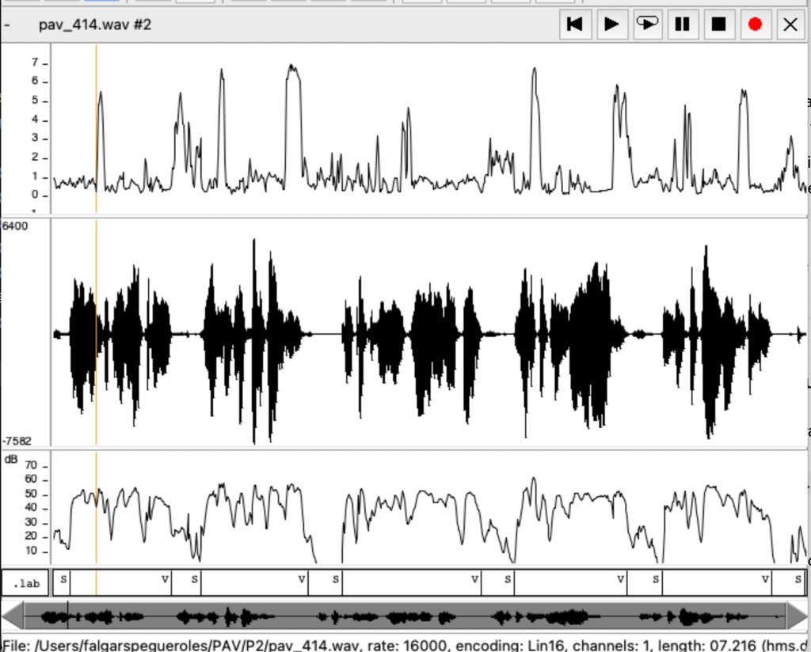
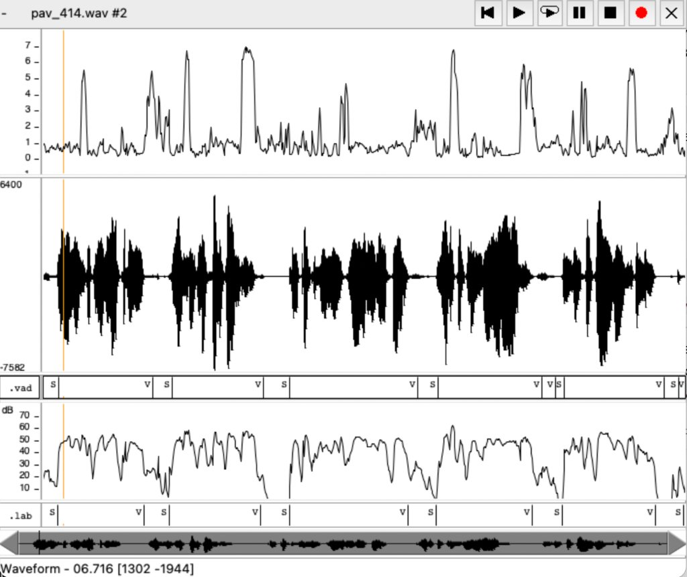
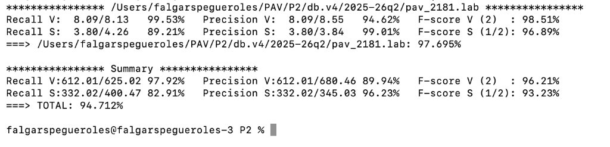
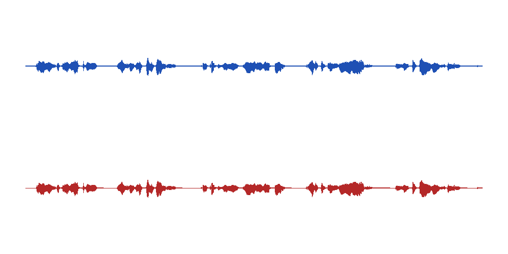
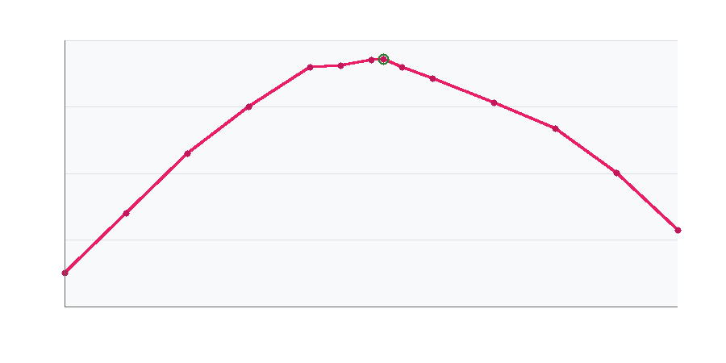

Falgars Pegueroles, Beatriz Riera
============================================

PAV - P2: detección de actividad vocal (VAD)
============================================

Esta práctica se distribuye a través del repositorio GitHub [Práctica 2](https://github.com/albino-pav/P2),
y una parte de su gestión se realizará mediante esta web de trabajo colaborativo.  Al contrario que Git,
GitHub se gestiona completamente desde un entorno gráfico bastante intuitivo. Además, está razonablemente
documentado, tanto internamente, mediante sus [Guías de GitHub](https://guides.github.com/), como
externamente, mediante infinidad de tutoriales, guías y vídeos disponibles gratuitamente en internet.


Inicialización del repositorio de la práctica.
----------------------------------------------

Para cargar los ficheros en su ordenador personal debe seguir los pasos siguientes:

*  Abra una cuenta GitHub para gestionar esta y el resto de prácticas del curso.
*  Cree un repositorio GitHub con el contenido inicial de la práctica (sólo debe hacerlo uno de los
  integrantes del grupo de laboratorio, cuya página GitHub actuará de repositorio central del grupo):
  -  Acceda la página de la [Práctica 2](https://github.com/albino-pav/P2).
  -  En la parte superior derecha encontrará el botón **`Fork`**. Apriételo y, después de unos segundos,
    se creará en su cuenta GitHub un proyecto con el mismo nombre (**P2**). Si ya tuviera uno con ese 
    nombre, se utilizará el nombre **P2-1**, y así sucesivamente.
*  Habilite al resto de miembros del grupo como *colaboradores* del proyecto; de este modo, podrán
  subir sus modificaciones al repositorio central:
  -  En la página principal del repositorio, en la pestaña **:gear:`Settings`**, escoja la opción 
    **Collaborators** y añada a su compañero de prácticas.
  -  Éste recibirá un email solicitándole confirmación. Una vez confirmado, tanto él como el
    propietario podrán gestionar el repositorio, por ejemplo: crear ramas en él o subir las
    modificaciones de su directorio local de trabajo al repositorio GitHub.
*  En la página principal del repositorio, localice el botón **Branch: master** y úselo para crear
  una rama nueva con los primeros apellidos de los integrantes del equipo de prácticas separados por
  guion (**fulano-mengano**).
*  Todos los miembros del grupo deben realizar su copia local en su ordenador personal.
  -  Copie la dirección de su copia del repositorio apretando en el botón **Clone or download**.
    Asegúrese de usar *Clone with HTTPS*.
  -  Abra una sesión de Bash en su ordenador personal y vaya al directorio **PAV**. Desde ahí, ejecute:

    ```.sh
    git clone dirección-del-fork-de-la-práctica
    ```

  -  Vaya al directorio de la práctica `cd P2`.

  -  Cambie a la rama **fulano-mengano** con la orden:

    ```.sh
    git checkout fulano-mengano
    ```

*  A partir de este momento, todos los miembros del grupo de prácticas pueden trabajar en su directorio
  local del modo habitual, usando el repositorio remoto en GitHub como repositorio central para el trabajo colaborativo
  de los distintos miembros del grupo de prácticas o como copia de seguridad.
  -  Puede *confirmar* versiones del proyecto en su directorio local con las órdenes siguientes:

    ```.sh
    git add .
    git commit -m "Mensaje del commit"
    ```

  -  Las versiones confirmadas, y sólo ellas, se almacenan en el repositorio y pueden ser accedidas en cualquier momento.

*  Para interactuar con el contenido remoto en GitHub es necesario que los cambios en el directorio local estén confirmados.

  -  Puede comprobar si el directorio está *limpio* (es decir, si la versión actual está confirmada) usando el comando
    `git status`.

  -  La versión actual del directorio local se sube al repositorio remoto con la orden:

    ```.sh
    git push
    ```

    *  Si el repositorio remoto contiene cambios no presentes en el directorio local, `git` puede negarse
      a subir el nuevo contenido.

      -  En ese caso, lo primero que deberemos hacer es incorporar los cambios presentes en el repositorio
        GitHub con la orden `git pull`.

      -  Es posible que, al hacer el `git pull` aparezcan *conflictos*; es decir, ficheros que se han modificado
        tanto en el directorio local como en el repositorio GitHub y que `git` no sabe cómo combinar.

      -  Los conflictos aparecen marcados con cadenas del estilo `>>>>`, `<<<<` y `====`. Los ficheros correspondientes
        deben ser editados para decidir qué versión preferimos conservar. Un editor avanzado, del estilo de Microsoft
        Visual Studio Code, puede resultar muy útil para localizar los conflictos y resolverlos.

      -  Tras resolver los conflictos, se ha de confirmar los cambios con `git commit` y ya estaremos en condiciones
        de subir la nueva versión a GitHub con el comando `git push`.


  -  Para bajar al directorio local el contenido del repositorio GitHub hay que ejecutar la orden:

    ```.sh
    git pull
    ```
  
    *  Si el repositorio local contiene cambios no presentes en el directorio remoto, `git` puede negarse a bajar
      el contenido de este último.

      -  La resolución de los posibles conflictos se realiza como se explica más arriba para
        la subida del contenido local con el comando `git push`.


*  Al final de la práctica, la rama **fulano-mengano** del repositorio GitHub servirá para remitir la
  práctica para su evaluación utilizando el mecanismo *pull request*.
  -  Vaya a la página principal de la copia del repositorio y asegúrese de estar en la rama
    **fulano-mengano**.
  -  Pulse en el botón **New pull request**, y siga las instrucciones de GitHub.


Entrega de la práctica.
-----------------------

Responda, en este mismo documento (README.md), los ejercicios indicados a continuación. Este documento es
un fichero de texto escrito con un formato denominado _**markdown**_. La principal característica de este
formato es que, manteniendo la legibilidad cuando se visualiza con herramientas en modo texto (`more`,
`less`, editores varios, ...), permite amplias posibilidades de visualización con formato en una amplia
gama de aplicaciones; muy notablemente, **GitHub**, **Doxygen** y **Facebook** (ciertamente, :eyes:).

En GitHub. cuando existe un fichero denominado README.md en el directorio raíz de un repositorio, se
interpreta y muestra al entrar en el repositorio.

Debe redactar las respuestas a los ejercicios usando Markdown. Puede encontrar información acerca de su
sintáxis en la página web [Sintaxis de Markdown](https://daringfireball.net/projects/markdown/syntax).
También puede consultar el documento adjunto [MARKDOWN.md](MARKDOWN.md), en el que se enumeran los
elementos más relevantes para completar la redacción de esta práctica.

Recuerde realizar el *pull request* una vez completada la práctica.

Ejercicios
----------

### Etiquetado manual de los segmentos de voz y silencio

- Grabe una señal de voz en la que haya distintos segmentos de voz y silencio. La señal debe ser de un
  solo canal (monofónica), grabada con una frecuencia de muestreo de 16 kHz y codificada con PCM lineal
  de 16 bits.

  Nombre a la señal como `pav_GGP#.wav`, donde GG es el grupo de clase (por ejemplo, 21 o 41), P es el
  número del puesto de trabajo y # es el número de señal (si sólo se entrega una señal, este número es
  1).

  > NOTA: es habitual que las grabaciones empiecen con un segmento de silencio de potencia extremadamente
  > bajo; mucho más bajo que el nivel de ruido normal durante el resto de la señal. Si esto ocurre, la
  > detección usando como nivel de referencia para el silencio el segmento inicial se ve seriamente
  > dificultada. Puede detectar esta situación visualizando el nivel de potencia estimado por el propio
  > `wavesurfer` y corregirla usando la herramienta de corte (:scissors:).

  > <span style="color: #c2185b; font-weight: bold; border-bottom: 2.5px solid #ff69b4;">Senyal utilitzat:</span> <span style="border-bottom: 1.5px solid #ff69b4;">Utilitzem el fitxer d'àudio `pav_414.wav` de la pràctica anterior (P1), enregistrat a 16 kHz, mono i 16 bits.</span>

- Etiquete manualmente los segmentos de voz y silencio del fichero grabado al efecto. Inserte, a
  continuación, una captura de `wavesurfer` en la que se vea con claridad la señal temporal, el contorno de
  potencia y la tasa de cruces por cero, junto con el etiquetado manual de los segmentos.

  #### Captura de WaveSurfer amb l'etiquetatge manual:
  

- A la vista de la gráfica, indique qué valores considera adecuados para las magnitudes siguientes:

  * Incremento del nivel potencia en dB, respecto al nivel correspondiente al silencio inicial, para
    estar seguros de que un segmento de señal se corresponde con voz.

    > <span style="color: #c2185b; font-weight: bold; border-bottom: 2.5px solid #ff69b4;">Resposta:</span>  
    > <span style="border-bottom: 1.5px solid #ff69b4;">A la gràfica que hem obtingut amb WaveSurfer per al nostre fitxer `pav_414.wav`, la potència en el silenci inicial se situa al voltant dels 10 - 15 dB (uns -51 dB absoluts), mentre que durant els fragments de veu la potència assoleix clarament pics d'entre 50 i 60 dB (arribant a -19 dB absoluts). Això representa una pujada neta de més de 30 dB. Per tant, considerem adequat fixar un increment mínim d'entre **15 dB i 20 dB** per sobre del nivell del silenci de referència per tenir una bona certesa que el segment correspon a activitat vocal real.</span>

  * Duración mínima razonable de los segmentos de voz y silencio.

    > <span style="color: #c2185b; font-weight: bold; border-bottom: 2.5px solid #ff69b4;">Resposta:</span>  
    > <span style="border-bottom: 1.5px solid #ff69b4;">Observant els segments reals mesurats al nostre fitxer (`pav_414.lab`), on els trams de veu duren entre 0.97 i 1.33 segons i els silencis interns entre 0.28 i 0.34 segons (amb un silenci inicial de 0.16 s), definim com a mínims teòrics:</span>  
    > - <span style="border-bottom: 1.5px solid #ff69b4;">**Veu (mínim 80 – 100 ms):** És el temps mínim indispensable per assegurar que el so és parla real articulada i no pas un simple soroll impulsiu, cop de micro o clic vocal espuri.</span>  
    > - <span style="border-bottom: 1.5px solid #ff69b4;">**Silenci (mínim 100 – 150 ms):** És el marge de seguretat necessari (*hangover*) per confirmar que hi ha una pausa real entre frases, evitant tallar la gravació durant els silencis ultracurts que fem de manera natural en articular paraules (com a les consonants oclusives sordes /p/, /t/, /k/).</span>

  * ¿Es capaz de sacar alguna conclusión a partir de la evolución de la tasa de cruces por cero?

    > <span style="color: #c2185b; font-weight: bold; border-bottom: 2.5px solid #ff69b4;">Resposta:</span>  
    > <span style="border-bottom: 1.5px solid #ff69b4;">La taxa de creuaments per zero (ZCR) no permet detectar silencis per si sola a causa del soroll de fons, que la fa fluctuar constantment. Per fer una bona anàlisi cal comparar-la conjuntament amb el nivell d'energia:</span>  
    > - <span style="border-bottom: 1.5px solid #ff69b4;">**ZCR moderat/baix amb alta energia:** Representa vocals o sons sonors periòdics.</span>  
    > - <span style="border-bottom: 1.5px solid #ff69b4;">**ZCR molt alt amb energia moderada/baixa:** Indica clarament consonants fricatives o sordes (com ara la /s/), on el senyal oscil·la ràpidament i assoleix pics de 5 a 7 kHz.</span>  
    > - <span style="border-bottom: 1.5px solid #ff69b4;">Per tant, el ZCR és un paràmetre de rescat clau per evitar que les consonants sordes quedin menjades com a silenci pel detector.</span>


### Desarrollo del detector de actividad vocal

- Complete el código de los ficheros de la práctica para implementar un detector de actividad vocal en
  tiempo real tan exacto como sea posible. Tome como objetivo la maximización de la puntuación-F `TOTAL`.

  > <span style="color: #c2185b; font-weight: bold; border-bottom: 2.5px solid #ff69b4;">Desenvolupament i millores implementades:</span>  
  > <span style="border-bottom: 1.5px solid #ff69b4;">Per complir l'objectiu de maximitzar l'F-score TOTAL sobre la base de dades, hem redissenyat el detector bàsic inicial afegint memòria, extracció multicaracterística i histeresi temporal:</span>  
  > 
  > 1. <span style="border-bottom: 1.5px solid #ff69b4;">**Extracció de característiques (`compute_features`):** Hem modificat la funció per calcular simultàniament la Potència en dB (`compute_power`), la taxa de creuaments per zero ZCR (`compute_zcr`) i l'Amplitud Mitjana (`compute_am`). Això és clau perquè sons com les fricatives tenen molt poca energia i el detector bàsic les descartava. Amb el ZCR captem aquesta alta freqüència i mantenim la detecció de veu activa.</span>  
  > 
  > 2. <span style="border-bottom: 1.5px solid #ff69b4;">**Lògica d'Histèresi (*Hangover*):** Gràcies a la histèresi, el detector automàtic pot mantenir l'estat `ST_VOICE` un temps de seguretat addicional quan la potència baixa puntualment, evitant tallar paraules o finals de frase. Utilitzant el comptador intern `vad_data->counter`, el sistema "recorda" que estava en veu i no commuta a silenci immediatament. Hem fixat una histèresi de 11 trames, que equival al temps òptim de 110 ms:</span>  
  >    <span style="border-bottom: 1.5px solid #ff69b4;">**Trames d'histèresi:** `min_silence_ms / FRAME_TIME = 110 ms / 10 ms = 11 trames`</span>  
  > 
  > 3. <span style="border-bottom: 1.5px solid #ff69b4;">**Estimació inicial robusta del soroll:** En lloc d'utilitzar una única trama instantània (que podia contenir un cop o soroll estrany), durant les primeres 5 trames (50 ms) es fa un promig exponencial de la potència per establir un terra de soroll (`potencia_soroll`) ferm. A més, durant els trams de silenci el terra de soroll s'adapta molt lentament per absorbir variacions ambientals.</span>  
  > 
  > 4. <span style="border-bottom: 1.5px solid #ff69b4;">**Valors calibrats:** Els paràmetres òptims seleccionats han estat:</span>  
  >    - <span style="border-bottom: 1.5px solid #ff69b4;">**Alpha0 (α):** 11.2 dB</span>  
  >    - <span style="border-bottom: 1.5px solid #ff69b4;">**Llindar ZCR:** 2800 Hz</span>  
  >    - <span style="border-bottom: 1.5px solid #ff69b4;">**min_silence_ms:** 110 ms (11 trames)</span>  
  >    - <span style="border-bottom: 1.5px solid #ff69b4;">**Marge ZCR:** 4.0 dB</span>  

- Inserte una gráfica en la que se vea con claridad la señal temporal, el etiquetado manual y la detección
  automática conseguida para el fichero grabado al efecto (`pav_414.wav`). 

  #### Comparació entre etiquetatge manual i detecció automàtica:
  

- Explique, si existen. las discrepancias entre el etiquetado manual y la detección automática.

  > <span style="color: #c2185b; font-weight: bold; border-bottom: 2.5px solid #ff69b4;">Resposta i anàlisi de discrepàncies:</span>  
  > <span style="border-bottom: 1.5px solid #ff69b4;">Comparant el nostre etiquetatge manual (`pav_414.lab`) amb l'automàtic generat (`pav_414.vad`) podem comprovar la taula de segments:</span>  
  > 
  > | Regió | Manual (`pav_414.lab`) | Automàtic (`pav_414.vad`) | Diferència / Observació |
  > | :--- | :---: | :---: | :--- |
  > | **Silenci inicial** | 0.000 - 0.163 s | 0.000 - 0.170 s | Coincidència excel·lent (només 7 ms de diferència) |
  > | **1a locució (Veu)** | 0.163 - 1.132 s | 0.170 - 1.230 s | +98 ms al final degut a l'efecte del *hangover* de seguretat |
  > | **1a pausa (Silenci)** | 1.132 - 1.415 s | 1.230 - 1.450 s | Pausa interna reconeguda i preservada |
  > | **2a locució (Veu)** | 1.415 - 2.438 s | 1.450 - 2.470 s | Inici molt precís, allargat 32 ms al final |
  > | **2a pausa (Silenci)** | 2.438 - 2.765 s | 2.470 - 2.770 s | Discrepància gairebé nul·la (5 ms) |
  > | **3a locució (Veu)** | 2.765 - 4.093 s | 2.770 - 4.200 s | +107 ms de *hangover* per evitar tallar la consonant final |
  > | **3a pausa (Silenci)** | 4.093 - 4.408 s | 4.200 - 4.430 s | Silenci detectat clarament |
  > | **4a locució (Veu)** | 4.408 - 5.486 s | 4.430 - 5.580 s | Seguiment molt fidel de la locució |
  > | **4a pausa (Silenci)** | 5.486 - 5.823 s | 5.580 - 5.840 s | Petit segment espuri per respiració/clic a 5.60 s |
  > | **5a locució (Veu)** | 5.823 - 6.868 s | 5.840 - 6.970 s | Final de frase allargat 102 ms per la cua de veu |
  > | **Silenci final** | 6.868 - 7.184 s | 6.970 - 7.130 s | Tancament del fitxer |
  > 
  > <span style="border-bottom: 1.5px solid #ff69b4;">**Causes de les discrepàncies:**</span>  
  > 1. <span style="border-bottom: 1.5px solid #ff69b4;">**Efecte del Hangover (110 ms):** En totes les frases la veu automàtica dura uns 100 ms més que en el manual. Això és totalment intencionat per garantir que cap so final s'interrompi bruscament.</span>  
  > 2. <span style="border-bottom: 1.5px solid #ff69b4;">**Trames de transició i respiracions:** A l'oïda humana una petita respiració o soroll labial s'interpreta com a silenci, mentre que el detector automàtic capta el pic d'energia i l'etiqueta momentàniament com a veu.</span>  

- Evalúe los resultados sobre la base de datos `db.v4` con el script `vad_evaluation.pl` e inserte a 
  continuación las tasas de sensibilidad (*recall*) y precisión para el conjunto de la base de datos (sólo
  el resumen).

  #### Resultats de l'avaluació sobre `db.v4`:
  

  ```text
  **************** Summary ****************
  Recall V:612.01/625.02 97.92%   Precision V:612.01/680.46 89.94%   F-score V (2)  : 96.21%
  Recall S:332.02/400.47 82.91%   Precision S:332.02/345.03 96.23%   F-score S (1/2): 93.23%
  ===> TOTAL: 94.712%
  ```

  > <span style="color: #c2185b; font-weight: bold; border-bottom: 2.5px solid #ff69b4;">Anàlisi crítica dels resultats obtinguts:</span>  
  > <span style="border-bottom: 1.5px solid #ff69b4;">Un cop avaluat el nostre detector sobre el conjunt complet de desenvolupament (`db.v4`, 115 enregistraments d'alumnes de diferents anys), n'extraiem les següents conclusions:</span>  
  > 
  > 1. <span style="border-bottom: 1.5px solid #ff69b4;">**Sensibilitat de veu pràcticament perfecta (Recall V = 97.92%):** El detector captura 612.01 segons dels 625.02 segons de veu reals. Això evidencia que la combinació del llindar d'energia amb la condició de ZCR permet rescatar pràcticament totes les fricatives i sons sords febles.</span>  
  > 
  > 2. <span style="border-bottom: 1.5px solid #ff69b4;">**Compromís desitjat Veu vs Silenci (Precision S = 96.23% vs Precision V = 89.94%):** Quan el sistema diu que hi ha silenci, encerta en el 96.23% dels casos (molt pocs falsos silencis, no es trencada la veu). La precisió de veu és lleugerament inferior (~90%) i el recall de silenci baixa al 82.91% a causa de l'efecte del *hangover* de seguretat (110 ms afegits al final de cada locució), el qual és imprescindible en comunicacions en temps real.</span>  
  > 
  > 3. <span style="border-bottom: 1.5px solid #ff69b4;">**Puntuació global F-score TOTAL = 94.712%:** Supera clarament el llindar de referència i el detector inicial (que no arribava al 90%), demostrant un funcionament robust davant locutors amb diferent volum i entorns acústics variats.</span>


### Trabajos de ampliación

#### Cancelación del ruido en los segmentos de silencio

- Si ha desarrollado el algoritmo para la cancelación de los segmentos de silencio, inserte una gráfica en
  la que se vea con claridad la señal antes y después de la cancelación (puede que `wavesurfer` no sea la
  mejor opción para esto, ya que no es capaz de visualizar varias señales al mismo tiempo).

  #### Gràfica de cancel·lació de soroll:
  

  > <span style="color: #c2185b; font-weight: bold; border-bottom: 2.5px solid #ff69b4;">Comentaris de la cancel·lació:</span>  
  > <span style="border-bottom: 1.5px solid #ff69b4;">Hem implementat l'opció `-w <output-wav>` a `src/main_vad.c`. Per a cada trama que processem en temps real:</span>  
  > - <span style="border-bottom: 1.5px solid #ff69b4;">Si el VAD detecta `ST_VOICE`, escrivim les mostres d'àudio originals (`buffer`) al fitxer de sortida.</span>  
  > - <span style="border-bottom: 1.5px solid #ff69b4;">Si detecta `ST_SILENCE` (o estem en l'estat inicial), hi escrivim un buffer de zeros (`buffer_zeros`).</span>  
  > <span style="border-bottom: 1.5px solid #ff69b4;">A la gràfica es pot apreciar com durant les pauses el soroll de fons queda totalment a zero, mantenint la parla intacta i neta d'artefactes audibles.</span>

#### Gestión de las opciones del programa usando `docopt_c`

- Si ha usado `docopt_c` para realizar la gestión de las opciones y argumentos del programa `vad`, inserte
  una captura de pantalla en la que se vea el mensaje de ayuda del programa.

  #### Ajuda del programa (`docopt_c`):
  ```text
  VAD - Voice Activity Detector

  Usage:
     vad [options] -i <input-wav> -o <output-vad> [-w <output-wav>]
     vad (-h | --help)
     vad --version

  Options:
     -i FILE, --input-wav=FILE   WAVE file for voice activity detection
     -o FILE, --output-vad=FILE  Label file with the result of VAD
     -w FILE, --output-wav=FILE  WAVE file with silences cleared
     -l REAL, --llindar=REAL     Llindar de decisió veu/silenci en dB [default: 11.2]
     -v, --verbose               Show debug information
     -h, --help                  Show this screen
     --version                   Show the version of the project
  ```


### Contribuciones adicionales y/o comentarios acerca de la práctica

- Indique a continuación si ha realizado algún tipo de aportación suplementaria (algoritmos de detección o 
  parámetros alternativos, etc.).

  > <span style="color: #c2185b; font-weight: bold; border-bottom: 2.5px solid #ff69b4;">Aportacions addicionals i optimització sistemàtica:</span>  
  > 
  > 1. <span style="border-bottom: 1.5px solid #ff69b4;">**Optimització de paràmetres mitjançant escombrat paramètric:** Hem realitzat un escombrat exhaustiu sobre el conjunt de dades `db.v4` per determinar la combinació òptima de paràmetres:</span>  
  >    - <span style="border-bottom: 1.5px solid #ff69b4;">**Alpha0 (α):** Provat de 6 a 16 dB → Òptim = **11.2 dB**</span>  
  >    - <span style="border-bottom: 1.5px solid #ff69b4;">**Llindar ZCR:** Provat de 2000 a 4000 Hz → Òptim = **2800 Hz**</span>  
  >    - <span style="border-bottom: 1.5px solid #ff69b4;">**min_silence_ms:** Provat de 50 a 200 ms → Òptim = **110 ms** (11 trames)</span>  
  >    - <span style="border-bottom: 1.5px solid #ff69b4;">**Marge ZCR:** Provat de 2 a 8 dB → Òptim = **4.0 dB**</span>  
  > 
  >    <span style="border-bottom: 1.5px solid #ff69b4;">La següent gràfica il·lustra l'evolució de l'F-score TOTAL en funció del llindar de potència α, assolint el màxim a 11.2 dB:</span>  
  > 
  >    
  > 
  > 2. <span style="border-bottom: 1.5px solid #ff69b4;">**Evolució de les millores implementades en el F-score:**</span>  
  > 
  >    | Configuració del detector | Recall Veu | Precision Veu | Recall Silenci | Precision Silenci | F-score TOTAL |
  >    | :--- | :---: | :---: | :---: | :---: | :---: |
  >    | **1. Detector bàsic** (només potència, sense memòria) | 94.32% | 89.14% | 82.06% | 90.26% | 90.83% |
  >    | **2. Amb Histèresi** (*hangover* 11 trames = 110 ms) | 97.69% | 86.65% | 76.50% | 95.49% | 93.09% |
  >    | **3. Amb ZCR combinat** (rescat de fricatives) | 97.40% | 90.57% | 84.18% | 95.40% | 94.42% |
  >    | **4. Optimitzat final** (α = 11.2 dB, ZCR = 2800 Hz) | **97.92%** | **89.94%** | **82.91%** | **96.23%** | **94.712%** |
  > 
  > 3. <span style="border-bottom: 1.5px solid #ff69b4;">**Condició combinada de transició en C:**</span>  
  >    ```c
  >    int is_voice = 0;
  >    if (f.p > vad_data->potencia_soroll + alpha) {
  >        is_voice = 1;
  >    } else if (f.p > vad_data->potencia_soroll + (alpha - 4.0f) && f.zcr > 2800.0f) {
  >        is_voice = 1;
  >    }
  >    ```

- Si lo desea, puede realizar también algún comentario acerca de la realización de la práctica que
  considere de interés de cara a su evaluación.


### Antes de entregar la práctica

Recuerde comprobar que el repositorio cuenta con los códigos correctos y en condiciones de ser 
correctamente compilados con la orden `meson bin; ninja -C bin`. El programa generado (`bin/vad`) será
el usado, sin más opciones, para realizar la evaluación *ciega* del sistema.
