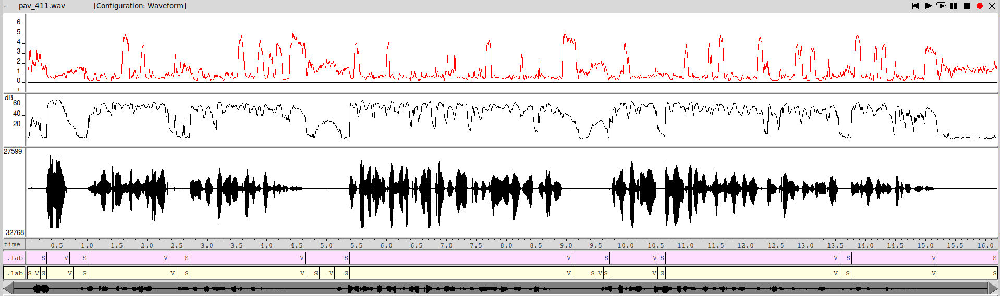
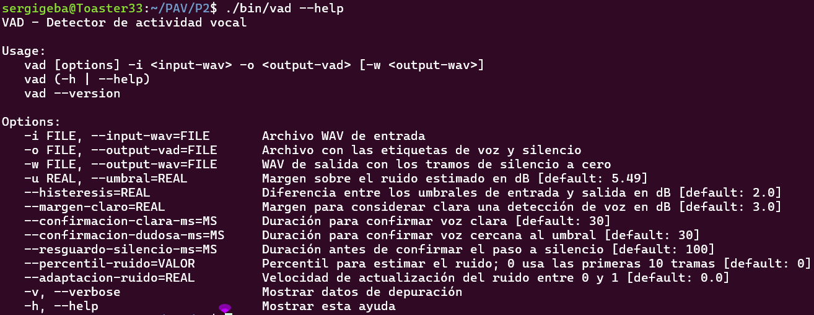

# P2: Detector de actividad vocal

## Objetivo

La práctica consiste en marcar qué partes de una grabación contienen voz y cuáles son silencio. El detector analiza la potencia en tramas cortas y cambia de estado cuando se mantienen las condiciones durante cierto tiempo.

## 1. Grabación y etiquetado manual

Para el etiquetado manual se utilizó `pav_411.wav`, una grabación mono a 16 kHz con muestras PCM de 16 bits. Se trabajó con WaveSurfer y se recortó el silencio inicial de potencia muy baja antes de marcar los tramos.

En la escala de potencia de WaveSurfer, el ruido de fondo está aproximadamente entre 20 y 25 dB y la voz suele superar los 40 dB. Son valores orientativos. Para las etiquetas manuales se marcaron como silencio las pausas claras, sin separar las interrupciones breves que forman parte de las palabras.

El ZCR cuenta los cambios de signo de la señal. Ayuda a describir algunos sonidos, aunque el ruido también puede tener un ZCR alto. Por eso se calcula y se muestra, pero el detector decide usando la potencia.

La imagen corresponde a una prueba de la variante adaptativa, que obtuvo 94,291 % en `db.v4`. El primer panel muestra el ZCR y el segundo la potencia. Las etiquetas manuales aparecen en magenta y las automáticas en amarillo, debajo se ve la señal ampliada y la vista general.



## 2. Detector

El programa divide la señal en tramas de 10 ms. En la configuración seleccionada, estima el ruido con las primeras 10 tramas y usa ese valor como referencia. El umbral de entrada a voz se calcula sumando al ruido el margen indicado con `-u`, cuyo valor predeterminado es 5,49 dB. Para volver a silencio se aplica un umbral 2 dB menor.

La voz se confirma después de 30 ms. El paso a silencio se confirma tras 100 ms por debajo del umbral de salida. Cuando se confirma un cambio, el programa retrocede el límite hasta la primera trama candidata para reducir el retraso.

También se puede probar una estimación alternativa con `--percentil-ruido 20`, que hace una pasada inicial por el archivo. `--adaptacion-ruido` permite controlar cuánto cambia la referencia durante los tramos de silencio. Estas opciones se probaron, pero no dieron el mejor resultado global de `db.v4`.

Con `-v` se muestran el tiempo, el estado, la potencia, el ZCR, el nivel de ruido y los umbrales de cada trama.

## 3. Evaluación sobre `db.v4`

Al probar distintos valores de para el umbral, la mejor ejecución anterior obtuvo 94,843 % con un umbral de 5,49 dB y la corrección temporal de los límites. Este es el resumen por clases de esa ejecución:

| Clase | Sensibilidad | Precisión | F-score |
|---|---:|---:|---:|
| Voz | 97,12 % | 92,50 % | 96,16 % (β = 2) |
| Silencio | 87,70 % | 95,13 % | 93,54 % (β = 0,5) |
| **Total** |  |  | **94,843 %** |

Después se probó la estimación por percentil 20, con actualización del ruido de 0,01. Con confirmación fija de 30 ms obtuvo 94,074 %; al cambiar la confirmación a 30 o 50 ms según la potencia de la primera trama, obtuvo 94,291 %. La última evaluación con los valores predeterminados restaurados dio 94,796 %. Es prácticamente el mismo resultado al redondear a una décima (94,8 %), aunque la mejor medición anterior sigue siendo 94,843 %.

## 4. Revisión auditiva de ejemplos

Se escucharon ejemplos con puntuaciones altas, medias y bajas para identificar qué condiciones podían explicar los aciertos y los errores. La revisión manual de los dos integrantes ayudó a decidir qué audios convenía analizar con más detalle y qué cambios probar.

- En `pav_2171.wav` la voz se distingue con claridad de un ruido suave, parecido a una brisa o interferencia.
- En `pav_2361.wav` las pausas son más largas y separan mejor los tramos de voz y silencio.
- En `pav_2109.wav` hay un ruido de fondo parecido a un petardeo, con un volumen cercano al de la voz.
- En `pav_2121.wav` la grabación tiene poco nivel. Subir el volumen del portátil ayuda a escucharla, pero no cambia la amplitud que procesa el programa.

En `db.v4` hay varias grabaciones con los nombres `pav_2171`, `pav_2121` y `pav_2361`, por eso se muestra el rango de sus resultados:

| Archivo | Grabaciones | Acierto obtenido |
|---|---:|---:|
| `pav_2109` | 1 | 98,016 % |
| `pav_2171` | 9 | 89,953–99,489 % |
| `pav_2121` | 6 | 77,695–99,454 % |
| `pav_2361` | 2 | 98,438–99,217 % |

Los porcentajes corresponden a las distintas grabaciones encontradas en los cursos de la base; no son una única cifra por nombre.

La revisión mostró que una misma configuración no obtiene el mismo resultado en todos los audios. Por eso se probaron ajustes para adaptar la referencia de ruido y los tiempos de confirmación. En `db.v4`, esos cambios no superaron la puntuación de la configuración anterior.

## 5. Ampliación

La opción `-w` permite crear un WAV de salida poniendo a cero los tramos que el detector clasifica como silencio. No aplica una cancelación espectral del ruido.

Los parámetros del detector se pueden cambiar desde la línea de comandos:

- `-u` o `--umbral`: margen sobre el ruido estimado; valor predeterminado, 5,49 dB.
- `--histeresis`: diferencia entre los umbrales de entrada y salida; predeterminado, 2 dB.
- `--margen-claro`: margen para considerar clara la detección de voz; predeterminado, 3 dB.
- `--confirmacion-clara-ms` y `--confirmacion-dudosa-ms`: tiempos para confirmar voz; predeterminados, 30 ms cada uno.
- `--resguardo-silencio-ms`: tiempo para confirmar el paso a silencio; predeterminado, 100 ms.
- `--percentil-ruido`: percentil para una pasada inicial por todo el archivo; el valor 0 usa las primeras 10 tramas y es el predeterminado.
- `--adaptacion-ruido`: velocidad de actualización del nivel de ruido; predeterminado, 0, que deja fija la referencia después de la calibración inicial.

Las duraciones se convierten a tramas de 10 ms. Meson genera la cabecera de `docopt_c` al compilar, a partir de `src/vad.docopt`.

Esta captura muestra la ayuda y los valores predeterminados de la configuración actual:



## Compilación y evaluación

Desde la carpeta `P2`:

```sh
meson setup --reconfigure bin
ninja -C bin
scripts/run_vad.sh 5.49
```

Para generar etiquetas y un WAV con los silencios detectados puestos a cero:

```sh
./bin/vad -i pav_411.wav -o pav_411_auto.vad -w pav_411_silenciado.wav
```

## Comentarios finales

La puntuación de `db.v4` permitió escoger los parámetros con mejor resultado en esa base. La escucha de ejemplos concretos ayudó a entender por qué el ruido de fondo, el nivel de grabación y la duración de las pausas pueden cambiar la detección. El comportamiento en audios distintos se tendrá que comprobar con nuevas evaluaciones.