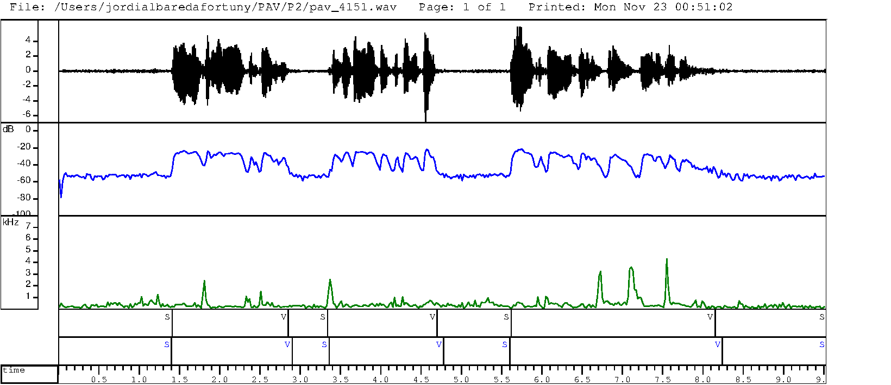
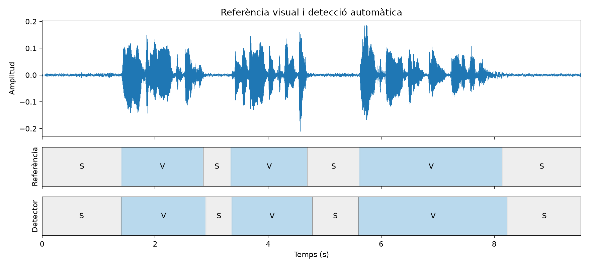
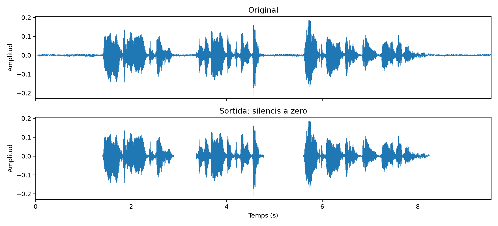
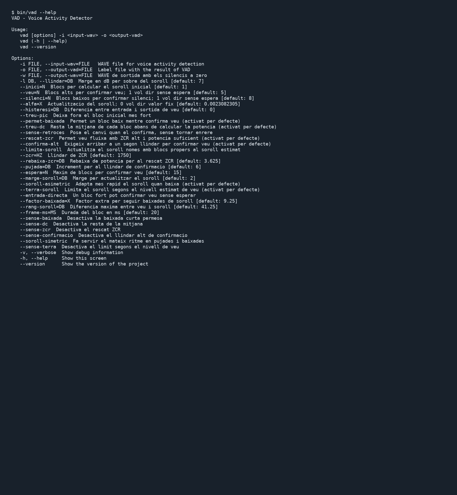
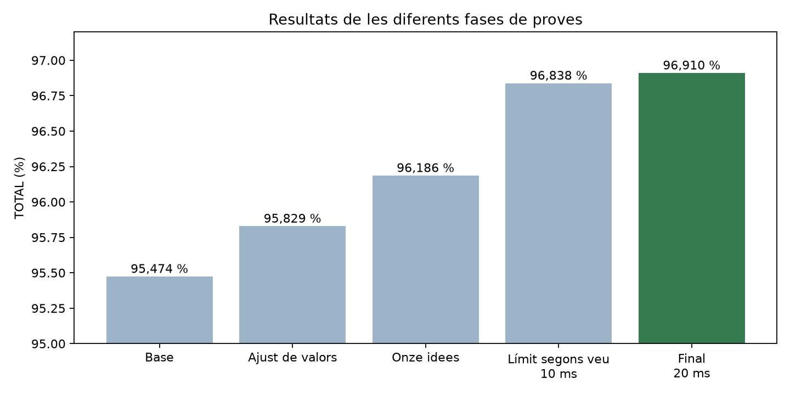

Jordi Albareda Fortuny i Víctor López
==================================

Grup 41 · Lloc 05 · Branca `albareda-lopez`

PAV - P2: detección de actividad vocal (VAD)
============================================

Esta práctica se distribuye a través del repositorio GitHub [Práctica 2](https://github.com/albino-pav/P2),
y una parte de su gestión se realizará mediante esta web de trabajo colaborativo.  Al contrario que Git,
GitHub se gestiona completamente desde un entorno gráfico bastante intuitivo. Además, está razonablemente
documentado, tanto internamente, mediante sus [Guías de GitHub](https://guides.github.com/), como
externamente, mediante infinidad de tutoriales, guías y vídeos disponibles gratuitamente en internet.


Inicialización del repositorio de la práctica.
----------------------------------------------

Para cargar los ficheros en su ordenador personal debe seguir los pasos siguientes:

*  Abra una cuenta GitHub para gestionar esta y el resto de prácticas del curso.
*  Cree un repositorio GitHub con el contenido inicial de la práctica (sólo debe hacerlo uno de los
  integrantes del grupo de laboratorio, cuya página GitHub actuará de repositorio central del grupo):
  -  Acceda la página de la [Práctica 2](https://github.com/albino-pav/P2).
  -  En la parte superior derecha encontrará el botón **`Fork`**. Apriételo y, después de unos segundos,
    se creará en su cuenta GitHub un proyecto con el mismo nombre (**P2**). Si ya tuviera uno con ese
    nombre, se utilizará el nombre **P2-1**, y así sucesivamente.
*  Habilite al resto de miembros del grupo como *colaboradores* del proyecto; de este modo, podrán
  subir sus modificaciones al repositorio central:
  -  En la página principal del repositorio, en la pestaña **:gear:`Settings`**, escoja la opción
    **Collaborators** y añada a su compañero de prácticas.
  -  Éste recibirá un email solicitándole confirmación. Una vez confirmado, tanto él como el
    propietario podrán gestionar el repositorio, por ejemplo: crear ramas en él o subir las
    modificaciones de su directorio local de trabajo al repositorio GitHub.
*  En la página principal del repositorio, localice el botón **Branch: master** y úselo para crear
  una rama nueva con los primeros apellidos de los integrantes del equipo de prácticas separados por
  guion (**fulano-mengano**).
*  Todos los miembros del grupo deben realizar su copia local en su ordenador personal.
  -  Copie la dirección de su copia del repositorio apretando en el botón **Clone or download**.
    Asegúrese de usar *Clone with HTTPS*.
  -  Abra una sesión de Bash en su ordenador personal y vaya al directorio **PAV**. Desde ahí, ejecute:

    ```.sh
    git clone dirección-del-fork-de-la-práctica
    ```

  -  Vaya al directorio de la práctica `cd P2`.

  -  Cambie a la rama **fulano-mengano** con la orden:

    ```.sh
    git checkout fulano-mengano
    ```

*  A partir de este momento, todos los miembros del grupo de prácticas pueden trabajar en su directorio
  local del modo habitual, usando el repositorio remoto en GitHub como repositorio central para el trabajo colaborativo
  de los distintos miembros del grupo de prácticas o como copia de seguridad.
  -  Puede *confirmar* versiones del proyecto en su directorio local con las órdenes siguientes:

    ```.sh
    git add .
    git commit -m "Mensaje del commit"
    ```

  -  Las versiones confirmadas, y sólo ellas, se almacenan en el repositorio y pueden ser accedidas en cualquier momento.

*  Para interactuar con el contenido remoto en GitHub es necesario que los cambios en el directorio local estén confirmados.

  -  Puede comprobar si el directorio está *limpio* (es decir, si la versión actual está confirmada) usando el comando
    `git status`.

  -  La versión actual del directorio local se sube al repositorio remoto con la orden:

    ```.sh
    git push
    ```

    *  Si el repositorio remoto contiene cambios no presentes en el directorio local, `git` puede negarse
      a subir el nuevo contenido.

      -  En ese caso, lo primero que deberemos hacer es incorporar los cambios presentes en el repositorio
        GitHub con la orden `git pull`.

      -  Es posible que, al hacer el `git pull` aparezcan *conflictos*; es decir, ficheros que se han modificado
        tanto en el directorio local como en el repositorio GitHub y que `git` no sabe cómo combinar.

      -  Los conflictos aparecen marcados con cadenas del estilo `>>>>`, `<<<<` y `====`. Los ficheros correspondientes
        deben ser editados para decidir qué versión preferimos conservar. Un editor avanzado, del estilo de Microsoft
        Visual Studio Code, puede resultar muy útil para localizar los conflictos y resolverlos.

      -  Tras resolver los conflictos, se ha de confirmar los cambios con `git commit` y ya estaremos en condiciones
        de subir la nueva versión a GitHub con el comando `git push`.


  -  Para bajar al directorio local el contenido del repositorio GitHub hay que ejecutar la orden:

    ```.sh
    git pull
    ```

    *  Si el repositorio local contiene cambios no presentes en el directorio remoto, `git` puede negarse a bajar
      el contenido de este último.

      -  La resolución de los posibles conflictos se realiza como se explica más arriba para
        la subida del contenido local con el comando `git push`.


*  Al final de la práctica, la rama **fulano-mengano** del repositorio GitHub servirá para remitir la
  práctica para su evaluación utilizando el mecanismo *pull request*.
  -  Vaya a la página principal de la copia del repositorio y asegúrese de estar en la rama
    **fulano-mengano**.
  -  Pulse en el botón **New pull request**, y siga las instrucciones de GitHub.


Entrega de la práctica.
-----------------------

Responda, en este mismo documento (README.md), los ejercicios indicados a continuación. Este documento es
un fichero de texto escrito con un formato denominado _**markdown**_. La principal característica de este
formato es que, manteniendo la legibilidad cuando se visualiza con herramientas en modo texto (`more`,
`less`, editores varios, ...), permite amplias posibilidades de visualización con formato en una amplia
gama de aplicaciones; muy notablemente, **GitHub**, **Doxygen** y **Facebook** (ciertamente, :eyes:).

En GitHub. cuando existe un fichero denominado README.md en el directorio raíz de un repositorio, se
interpreta y muestra al entrar en el repositorio.

Debe redactar las respuestas a los ejercicios usando Markdown. Puede encontrar información acerca de su
sintáxis en la página web [Sintaxis de Markdown](https://daringfireball.net/projects/markdown/syntax).
También puede consultar el documento adjunto [MARKDOWN.md](MARKDOWN.md), en el que se enumeran los
elementos más relevantes para completar la redacción de esta práctica.

Recuerde realizar el *pull request* una vez completada la práctica.

Ejercicios
----------

### Etiquetado manual de los segmentos de voz y silencio

- Grabe una señal de voz en la que haya distintos segmentos de voz y silencio. La señal debe ser de un
  solo canal (monofónica), grabada con una frecuencia de muestreo de 16 kHz y codificada con PCM lineal
  de 16 bits.

  Nombre a la señal como `pav_GGP#.wav`, donde GG es el grupo de clase (por ejemplo, 21 o 41), P es el
  número del puesto de trabajo y # es el número de señal (si sólo se entrega una señal, este número es
  1).

  > NOTA: es habitual que las grabaciones empiecen con un segmento de silencio de potencia extremadamente
  > bajo; mucho más bajo que el nivel de ruido normal durante el resto de la señal. Si esto ocurre, la
  > detección usando como nivel de referencia para el silencio el segmento inicial se ve seriamente
  > dificultada. Puede detectar esta situación visualizando el nivel de potencia estimado por el propio
  > `wavesurfer` y corregirla usando la herramienta de corte (:scissors:).

**Resposta.** Fem servir la gravació de Jordi de la P1, mono, a 16 kHz i PCM de 16 bits. Dura **9,536 s**. A l’entrega l’hem anomenat `pav_4151.wav`: grup 41, lloc 5 i gravació 1. Les mostres són les mateixes que a les proves anteriors; només hem canviat el nom.

Els fitxers són [pav_4151.wav](pav_4151.wav), [pav_4151.lab](pav_4151.lab) i [pav_4151.vad](pav_4151.vad).


- Etiquete manualmente los segmentos de voz y silencio del fichero grabado al efecto. Inserte, a
  continuación, una captura de `wavesurfer` en la que se vea con claridad la señal temporal, el contorno de
  potencia y la tasa de cruces por cero, junto con el etiquetado manual de los segmentos.

**Resposta.** Hem mantingut les marques manuals que ja teníem de la gravació. No les hem canviat per fer-les coincidir amb el detector.



De dalt a baix hi ha el senyal, la potència, el ZCR, les marques manuals en negre i la detecció automàtica en blau.

| Inici (s) | Final (s) | Etiqueta |
|---:|---:|:---:|
| 0,000 | 1,410 | S |
| 1,410 | 2,850 | V |
| 2,850 | 3,340 | S |
| 3,340 | 4,700 | V |
| 4,700 | 5,620 | S |
| 5,620 | 8,150 | V |
| 8,150 | 9,536 | S |


- A la vista de la gráfica, indique qué valores considera adecuados para las magnitudes siguientes:

  * Incremento del nivel potencia en dB, respecto al nivel correspondiente al silencio inicial, para
    estar seguros de que un segmento de señal se corresponde con voz.

  **Resposta.** Hem provat diferents marges i ens hem quedat amb **7 dB per sobre del soroll**. El silenci inicial complet té una potència d’uns −52,40 dB. El primer bloc de 20 ms, després de restar-ne la mitjana, dona −57,59 dB. Aquest és el que fa servir el detector per començar: el primer llindar és aproximadament −50,59 dB.

  Després el soroll es va actualitzant. També demanem que algun bloc arribi 6 dB per sobre del llindar d’entrada per confirmar la veu, i permetem un llindar 3,625 dB més baix si el ZCR supera 1.750 Hz.


  * Duración mínima razonable de los segmentos de voz y silencio.

  **Resposta.** Fem servir **100 ms per confirmar veu** i **160 ms per confirmar silenci**. Amb els blocs de 20 ms són cinc i vuit blocs. Podem permetre un bloc baix entremig mentre confirmem la veu, però no compta entre els cinc blocs alts.

  Les dues pauses internes de les marques manuals duren 490 i 920 ms. Els 160 ms permeten detectar-les sense tallar cada baixada curta dins d’una paraula.


  * ¿Es capaz de sacar alguna conclusión a partir de la evolución de la tasa de cruces por cero?

  **Resposta.** El ZCR no separa tot sol la veu del silenci. Pot ser alt en una consonant fluixa, però també en soroll. Per això el combinem amb la potència: només ajuda si el bloc supera un segon llindar d’energia, una mica més baix que el normal.

  A la nostra gravació, amb blocs de 20 ms, el ZCR mitjà del silenci inicial és d’uns 345 Hz i el màxim del fitxer és d’uns 4.313 Hz. El llindar de 1.750 Hz s’ha triat amb la base de dades, no només amb aquesta gravació.


### Desarrollo del detector de actividad vocal

- Complete el código de los ficheros de la práctica para implementar un detector de actividad vocal en
  tiempo real tan exacto como sea posible. Tome como objetivo la maximización de la puntuación-F `TOTAL`.

**Resposta.** Hem mantingut l’autòmat amb els estats `INIT`, `SILENCE`, `MAYBE_VOICE`, `VOICE` i `MAYBE_SILENCE`.

1. Al començament calculem el soroll amb el primer bloc de 20 ms.
2. Si la potència supera el llindar, comencem a comptar blocs de possible veu. El ZCR pot ajudar amb els blocs de poca potència.
3. Confirmem veu quan hi ha cinc blocs alts i n’hi ha hagut algun que arribi al llindar de confirmació. Si no es confirma abans de 300 ms, descartem l’intent.
4. Quan la potència baixa, esperem vuit blocs per confirmar silenci. Si torna a pujar, continuem en veu.
5. Quan es confirma un canvi, el límit torna al primer bloc que havia quedat pendent. La sortida només té `S` i `V`.

Durant el silenci actualitzem el soroll a poc a poc quan puja i més ràpid quan baixa. També estimem el nivell de veu per evitar que el soroll quedi massa per sota seu. Abans de calcular la potència restem la mitjana de cada bloc.

#### Valors que hem deixat per defecte

| Paràmetre | Valor |
|---|---:|
| Bloc | 20 ms |
| Inicialització | 1 bloc: 20 ms |
| Veu mínima | 5 blocs: 100 ms |
| Silenci mínim | 8 blocs: 160 ms |
| Marge sobre el soroll | 7 dB |
| Actualització del soroll, alfa | 0,0023082305 per bloc |
| Factor quan el soroll baixa | 9,25 |
| Diferència màxima entre veu i soroll | 41,25 dB |
| Llindar de ZCR | 1.750 Hz |
| Rebaixa de potència amb ZCR alt | 3,625 dB |
| Pujada per confirmar la veu | 6 dB |
| Espera màxima per confirmar | 15 blocs: 300 ms |

No cal escriure aquests valors per executar el resultat final:

```sh
meson setup bin
ninja -C bin
bin/vad -i pav_4151.wav -o pav_4151.vad
```

La histèresi d’entrada i sortida, treure el pic inicial, limitar l’actualització als blocs propers al soroll i l’entrada directa queden apagats. Les proves d’aquestes idees es conserven a les etiquetes d’arxiu.


- Inserte una gráfica en la que se vea con claridad la señal temporal, el etiquetado manual y la detección
  automática conseguida para el fichero grabado al efecto.

#### Comparació de la gravació personal



Hem generat aquesta figura amb la sortida del programa d’aquesta branca, sense opcions addicionals.


- Explique, si existen. las discrepancias entre el etiquetado manual y la detección automática.

**Resposta.** El detector troba els tres fragments de veu. Les diferències són sobretot als límits:

| Fragment | Manual (s) | Detector (s) |
|---|---|---|
| 1 | 1,410–2,850 | 1,400–2,900 |
| 2 | 3,340–4,700 | 3,360–4,780 |
| 3 | 5,620–8,150 | 5,600–8,240 |

El segon fragment comença 20 ms tard. En canvi, els tres finals s’allarguen: 50, 80 i 90 ms. Hi ha trams fluixos que el programa manté dins de la veu tot i que les marques manuals els deixen fora.

Aquesta gravació dona **99,62 % de sensibilitat de veu**, **95,50 % de precisió de veu** i **98,565 % de TOTAL**. El resultat complet és a [evaluacio_personal_entrega.txt](resultats/evaluacio_personal_entrega.txt).


- Evalúe los resultados sobre la base de datos `db.v4` con el script `vad_evaluation.pl` e inserte a
  continuación las tasas de sensibilidad (*recall*) y precisión para el conjunto de la base de datos (sólo
  el resumen).

#### Resultat sobre `db.v4`

Hem passat les 115 gravacions al programa amb els valors per defecte i hem fet servir el `vad_evaluation.pl` original.

```text
Recall V:614.78/625.02 98.36%   Precision V:614.78/647.32 94.97%   F-score V (2)  : 97.67%
Recall S:367.93/400.47 91.87%   Precision S:367.93/378.16 97.29%   F-score S (1/2): 96.16%
===> TOTAL: 96.910%
```

| Estat | Sensibilitat | Precisió |
|---|---:|---:|
| Veu | 98,36 % | 94,97 % |
| Silenci | 91,87 % | 97,29 % |

El resultat complet és a [evaluacio_entrega.txt](resultats/evaluacio_entrega.txt). El TOTAL és el que calcula l’avaluador, amb `sqrt(F2(veu) * F0.5(silenci))`.

Els valors s’han ajustat amb aquesta mateixa base. Caldrien àudios nous per veure si la millora també es manté fora de `db.v4`.


### Trabajos de ampliación

#### Cancelación del ruido en los segmentos de silencio

- Si ha desarrollado el algoritmo para la cancelación de los segmentos de silencio, inserte una gráfica en
  la que se vea con claridad la señal antes y después de la cancelación (puede que `wavesurfer` no sea la
  mejor opción para esto, ya que no es capaz de visualizar varias señales al mismo tiempo).

**Resposta.** Hem afegit l’opció `-w` / `--output-wav`. El programa escriu un WAVE nou: conserva les mostres dels segments de veu i posa a zero les dels segments de silenci.

```sh
bin/vad -i pav_4151.wav -o pav_4151.vad -w pav_4151_sense_soroll.wav
```

#### Comparació abans i després



El fitxer continua durant **9,536 s**. No hem retallat les pauses ni canviat el volum de la veu. Si el detector marca un tros com a silenci, aquell tros queda a zero encara que les marques manuals diguin una altra cosa.

Esperem que el detector confirmi cada canvi abans d’escriure el segment. Així els blocs dubtosos es tracten igual que al fitxer d’etiquetes. Fem servir una segona lectura del mateix àudio per copiar les mostres originals de veu, sense carregar tot el fitxer en memòria.

Hem comprovat les 115 gravacions: les mostres de veu es conserven exactament i les de silenci són zero. Les etiquetes són les mateixes amb `-w` i sense. També hem provat àudios curts, finals incomplets i diferents formats PCM. El resum és a [comprovacio_ampliacions.txt](resultats/comprovacio_ampliacions.txt).

Per repetir aquesta comprovació i regenerar la figura:

```sh
python3 scripts/comprova_ampliacions.py
python3 scripts/grafica_cancelacio.py
```


#### Gestión de las opciones del programa usando `docopt_c`

- Si ha usado `docopt_c` para realizar la gestión de las opciones y argumentos del programa `vad`, inserte
  una captura de pantalla en la que se vea el mensaje de ayuda del programa.

**Resposta.** Hem fet servir `docopt_c` i hi hem afegit les opcions del detector. La configuració final ja és la predeterminada. Les opcions `--sense-zcr`, `--sense-confirmacio`, `--soroll-simetric`, `--sense-terra`, `--sense-dc` i `--sense-baixada` permeten apagar les millores per comparar-les.

#### Ajuda del programa



Per tornar a generar la capçalera després de canviar les opcions:

```sh
python3 docopt_c/docopt_c.py src/vad.docopt -o src/vad_docopt.h
ninja -C bin
```


### Contribuciones adicionales y/o comentarios acerca de la práctica

- Indique a continuación si ha realizado algún tipo de aportación suplementaria (algoritmos de detección o
  parámetros alternativos, etc.).

**Resposta.** Hem anat provant les idees per separat i juntes. A [IDEES.md](IDEES.md) hi ha l’origen de cada idea, les taules i els resultats. Hi indiquem també les idees que hem vist als altres PR, com el rescat amb ZCR i les dues velocitats del soroll. La confirmació amb llindar alt i la decisió diferida ja s’expliquen als apartats 1.3.2 i 1.3.3 del PDF de la pràctica.

#### Com ha anat canviant el resultat

| Fase de proves | TOTAL |
|---|---:|
| Detector base amb marge de 6 dB | 95,474 % |
| Ajust dels valors de la base | 95,829 % |
| Millor combinació de les onze idees | 96,186 % |
| Límit del soroll segons la veu, amb blocs de 10 ms | 96,838 % |
| Configuració final, amb blocs de 20 ms | **96,910 %** |



Cada fila és el millor ajust d’una fase. No és una prova on afegim una sola idea i deixem tots els altres valors iguals. La matriu d’`IDEES.md` permet mirar aquestes comparacions amb més detall.

En l’última prova hem comparat 48 casos i 42.790 configuracions. Hem mantingut els onze interruptors de la millor combinació anterior, hem afegit tres regles noves i hem provat sis durades de bloc. Això no és una cerca de totes les barreges possibles de les catorze regles.


- Si lo desea, puede realizar también algún comentario acerca de la realización de la práctica que
  considere de interés de cara a su evaluación.

**Resposta.** Ens ha anat bé guardar també les proves que empitjoraven el resultat. Per exemple, l’entrada directa pot acceptar un cop curt i no ha quedat activada al final. Amb el ZCR també hem mantingut un mínim de potència, perquè un ZCR alt pot ser soroll.

Hem comprovat la compilació des de zero, el resultat amb els valors per defecte i que les sortides tenen només `S` i `V`, sense buits ni solapaments. També hem provat àudios curts, silenci i blocs incomplets. El resum és a [comprovacio_entrega.txt](resultats/comprovacio_entrega.txt).


### Antes de entregar la práctica

Recuerde comprobar que el repositorio cuenta con los códigos correctos y en condiciones de ser
correctamente compilados con la orden `meson bin; ninja -C bin`. El programa generado (`bin/vad`) será
el usado, sin más opciones, para realizar la evaluación *ciega* del sistema.


**Comprovació de l’entrega.** La branca és `albareda-lopez`. El 96,910 % s’obté sense passar cap paràmetre del detector. Les etiquetes `arxiu/jordi-albareda-combinacions` i `arxiu/jordi-albareda-proves-pendents` conserven els scripts i els resultats de les cerques. Els enllaços d’[IDEES.md](IDEES.md) continuen funcionant.

**Fitxers per a Atenea.** ATENEA no em deixa penjar els 2 docus. Els deixem també en aquest repositori: [pav_4151.wav](pav_4151.wav) i [pav_4151.lab](pav_4151.lab).
