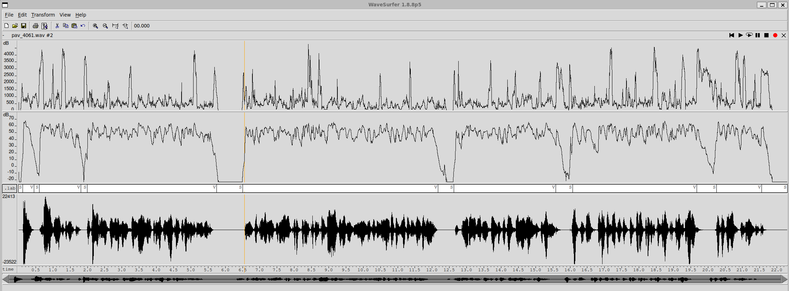
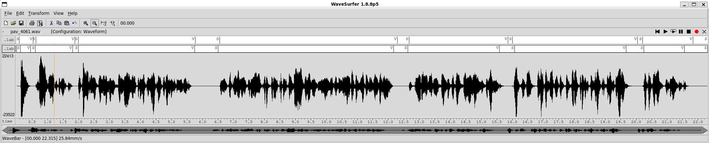

Berta Martínez i Alejandro Urioste
============================================ 

PAV - P2: detección de actividad vocal (VAD)
============================================

Esta práctica se distribuye a través del repositorio GitHub [Práctica 2](https://github.com/albino-pav/P2),
y una parte de su gestión se realizará mediante esta web de trabajo colaborativo.  Al contrario que Git,
GitHub se gestiona completamente desde un entorno gráfico bastante intuitivo. Además, está razonablemente
documentado, tanto internamente, mediante sus [Guías de GitHub](https://guides.github.com/), como
externamente, mediante infinidad de tutoriales, guías y vídeos disponibles gratuitamente en internet.


Inicialización del repositorio de la práctica.
----------------------------------------------

Para cargar los ficheros en su ordenador personal debe seguir los pasos siguientes:

*  Abra una cuenta GitHub para gestionar esta y el resto de prácticas del curso.
*  Cree un repositorio GitHub con el contenido inicial de la práctica (sólo debe hacerlo uno de los
  integrantes del grupo de laboratorio, cuya página GitHub actuará de repositorio central del grupo):
  -  Acceda la página de la [Práctica 2](https://github.com/albino-pav/P2).
  -  En la parte superior derecha encontrará el botón **`Fork`**. Apriételo y, después de unos segundos,
    se creará en su cuenta GitHub un proyecto con el mismo nombre (**P2**). Si ya tuviera uno con ese 
    nombre, se utilizará el nombre **P2-1**, y así sucesivamente.
*  Habilite al resto de miembros del grupo como *colaboradores* del proyecto; de este modo, podrán
  subir sus modificaciones al repositorio central:
  -  En la página principal del repositorio, en la pestaña **:gear:`Settings`**, escoja la opción 
    **Collaborators** y añada a su compañero de prácticas.
  -  Éste recibirá un email solicitándole confirmación. Una vez confirmado, tanto él como el
    propietario podrán gestionar el repositorio, por ejemplo: crear ramas en él o subir las
    modificaciones de su directorio local de trabajo al repositorio GitHub.
*  En la página principal del repositorio, localice el botón **Branch: master** y úselo para crear
  una rama nueva con los primeros apellidos de los integrantes del equipo de prácticas separados por
  guion (**fulano-mengano**).
*  Todos los miembros del grupo deben realizar su copia local en su ordenador personal.
  -  Copie la dirección de su copia del repositorio apretando en el botón **Clone or download**.
    Asegúrese de usar *Clone with HTTPS*.
  -  Abra una sesión de Bash en su ordenador personal y vaya al directorio **PAV**. Desde ahí, ejecute:

    ```.sh
    git clone dirección-del-fork-de-la-práctica
    ```

  -  Vaya al directorio de la práctica `cd P2`.

  -  Cambie a la rama **fulano-mengano** con la orden:

    ```.sh
    git checkout fulano-mengano
    ```

*  A partir de este momento, todos los miembros del grupo de prácticas pueden trabajar en su directorio
  local del modo habitual, usando el repositorio remoto en GitHub como repositorio central para el trabajo colaborativo
  de los distintos miembros del grupo de prácticas o como copia de seguridad.
  -  Puede *confirmar* versiones del proyecto en su directorio local con las órdenes siguientes:

    ```.sh
    git add .
    git commit -m "Mensaje del commit"
    ```

  -  Las versiones confirmadas, y sólo ellas, se almacenan en el repositorio y pueden ser accedidas en cualquier momento.

*  Para interactuar con el contenido remoto en GitHub es necesario que los cambios en el directorio local estén confirmados.

  -  Puede comprobar si el directorio está *limpio* (es decir, si la versión actual está confirmada) usando el comando
    `git status`.

  -  La versión actual del directorio local se sube al repositorio remoto con la orden:

    ```.sh
    git push
    ```

    *  Si el repositorio remoto contiene cambios no presentes en el directorio local, `git` puede negarse
      a subir el nuevo contenido.

      -  En ese caso, lo primero que deberemos hacer es incorporar los cambios presentes en el repositorio
        GitHub con la orden `git pull`.

      -  Es posible que, al hacer el `git pull` aparezcan *conflictos*; es decir, ficheros que se han modificado
        tanto en el directorio local como en el repositorio GitHub y que `git` no sabe cómo combinar.

      -  Los conflictos aparecen marcados con cadenas del estilo `>>>>`, `<<<<` y `====`. Los ficheros correspondientes
        deben ser editados para decidir qué versión preferimos conservar. Un editor avanzado, del estilo de Microsoft
        Visual Studio Code, puede resultar muy útil para localizar los conflictos y resolverlos.

      -  Tras resolver los conflictos, se ha de confirmar los cambios con `git commit` y ya estaremos en condiciones
        de subir la nueva versión a GitHub con el comando `git push`.


  -  Para bajar al directorio local el contenido del repositorio GitHub hay que ejecutar la orden:

    ```.sh
    git pull
    ```
  
    *  Si el repositorio local contiene cambios no presentes en el directorio remoto, `git` puede negarse a bajar
      el contenido de este último.

      -  La resolución de los posibles conflictos se realiza como se explica más arriba para
        la subida del contenido local con el comando `git push`.


*  Al final de la práctica, la rama **fulano-mengano** del repositorio GitHub servirá para remitir la
  práctica para su evaluación utilizando el mecanismo *pull request*.
  -  Vaya a la página principal de la copia del repositorio y asegúrese de estar en la rama
    **fulano-mengano**.
  -  Pulse en el botón **New pull request**, y siga las instrucciones de GitHub.


Entrega de la práctica.
-----------------------

Responda, en este mismo documento (README.md), los ejercicios indicados a continuación. Este documento es
un fichero de texto escrito con un formato denominado _**markdown**_. La principal característica de este
formato es que, manteniendo la legibilidad cuando se visualiza con herramientas en modo texto (`more`,
`less`, editores varios, ...), permite amplias posibilidades de visualización con formato en una amplia
gama de aplicaciones; muy notablemente, **GitHub**, **Doxygen** y **Facebook** (ciertamente, :eyes:).

En GitHub. cuando existe un fichero denominado README.md en el directorio raíz de un repositorio, se
interpreta y muestra al entrar en el repositorio.

Debe redactar las respuestas a los ejercicios usando Markdown. Puede encontrar información acerca de su
sintáxis en la página web [Sintaxis de Markdown](https://daringfireball.net/projects/markdown/syntax).
También puede consultar el documento adjunto [MARKDOWN.md](MARKDOWN.md), en el que se enumeran los
elementos más relevantes para completar la redacción de esta práctica.

Recuerde realizar el *pull request* una vez completada la práctica.

Ejercicios
----------

### Etiquetado manual de los segmentos de voz y silencio

- Grabe una señal de voz en la que haya distintos segmentos de voz y silencio. La señal debe ser de un
  solo canal (monofónica), grabada con una frecuencia de muestreo de 16 kHz y codificada con PCM lineal
  de 16 bits.

  Nombre a la señal como `pav_GGP#.wav`, donde GG es el grupo de clase (por ejemplo, 21 o 41), P es el
  número del puesto de trabajo y # es el número de señal (si sólo se entrega una señal, este número es
  1).

  > NOTA: es habitual que las grabaciones empiecen con un segmento de silencio de potencia extremadamente
  > bajo; mucho más bajo que el nivel de ruido normal durante el resto de la señal. Si esto ocurre, la
  > detección usando como nivel de referencia para el silencio el segmento inicial se ve seriamente
  > dificultada. Puede detectar esta situación visualizando el nivel de potencia estimado por el propio
  > `wavesurfer` y corregirla usando la herramienta de corte (:scissors:).

- Etiquete manualmente los segmentos de voz y silencio del fichero grabado al efecto. Inserte, a
  continuación, una captura de `wavesurfer` en la que se vea con claridad la señal temporal, el contorno de potencia y la tasa de cruces por cero, junto con el etiquetado manual de los segmentos.



> **Respuesta:** En la captura se muestran los cuatro paneles sincronizados de la grabación `pav_4061.wav` ($f_s = 16\text{ kHz}$, duración total de $22\text{ s}$): la tasa de cruces por cero (ZCR), el contorno de potencia en decibelios (de $-20\text{ dB}$ a $70\text{ dB}$), la transcripción manual con las etiquetas `S` (silencio) y `V` (voz), y la forma de onda temporal

- A la vista de la gráfica, indique qué valores considera adecuados para las magnitudes siguientes:

  * Incremento del nivel potencia en dB, respecto al nivel correspondiente al silencio inicial, para estar seguros de que un segmento de señal se corresponde con voz.


> **Respuesta:** En la gráfica observamos que durante el silencio inicial y las pausas entre frases, el ruido se mantiene entre **$-25\text{ dB}$ y $-10\text{ dB}$** En cambio, durante los segmentos de voz (`V`), la potencia sube con valores de alrededor de **$40\text{--}65\text{ dB}$** en las vocales. Vemos algunos puntos concretos donde está en **$30\text{ dB}$** y lo podemos asociar a algunas consonantes débiles.Por tanto, fijar un incremento relativo de **$10\text{--}15\text{ dB}$** respecto al nivel de silencio inicial (nos daría el corte efectivo alrededor de $-8\text{ dB}$) ofrece el compromiso óptimo, es decir, es lo bastante alto para evitar falsas detecciones por pequeñas fluctuaciones del ruido de fondo, y lo bastante bajo para no recortar las consonantes débiles.

  * Duración mínima razonable de los segmentos de voz y silencio.


> **Respuesta:**
> * **Segmentos de voz (`V`):** La palabra aislada más breve de la grabación (*"Hola"*) tiene una duración aproximada de **$280\text{ ms}$**. Para el detector por tramas ($10\text{ ms}$),escogemos una duración mínima de **$30\text{--}50\text{ ms}$** ($3\text{--}5$ tramas) para filtrar ruidos sin recortar palabras cortas. 
> * **Segmentos de silencio (`S`):** La pausa más corta etiquetada entre palabras (después de "Hola") dura unos **$180\text{ ms}$**, mientras que las oclusiones internas de consonantes sordas (`/p/`, `/t/`, `/k/`) duran entre $50\text{ ms}$ y $100\text{ ms}$ y deben mantenerse dentro de `V`. És por eso, que una duración mínima razonable para decir que es silencio es de **$150\text{--}200\text{ ms}$** ($15\text{--}20$ tramas). 

  * ¿Es capaz de sacar alguna conclusión a partir de la evolución de la tasa de cruces por cero?

> **Respuesta:** Sí, la ZCR permite diferenciar claramente la naturaleza de los sonidos dentro de la señal
> * **Vocales y sonidos sonoros:** Presentan una potencia alta ($40\text{--}65\text{ dB}$) y una ZCR baja y estable, debido a la periodicidad de la voz.
> * **Consonantes fricativas sordas (`/s/`, `/f/`):** En palabras como *"somos"*, *"características"*, *"fricativas"* o en la *"s"* final de *"silencios"*, la potencia cae respecto a las vocales ($15\text{--}35\text{ dB}$) pero la ZCR presenta picos muy elevados de **$2500\text{--}4500\text{ Hz}$**.
> * **Silencios:** En silencio la ZCR cae a **$0\text{ Hz}$**, mientras que con ruido ambiente de baja energía oscila irregularmente ($200\text{--}1500\text{ Hz}$).
> * Aunque la ZRC no puede usarse sola por el ruido de fondo, combinada con la potencia resulta muy útil para no recortar fricativas sordas al inicio o final de palabra cuya energía cae cerca del umbral

### Desarrollo del detector de actividad vocal

- Complete el código de los ficheros de la práctica para implementar un detector de actividad vocal en tiempo real tan exacto como sea posible. Tome como objetivo la maximización de la puntuación-F `TOTAL`.

- Inserte una gráfica en la que se vea con claridad la señal temporal, el etiquetado manual y la detección automática conseguida para el fichero grabado al efecto. 



**Respuesta:** En la captura se muestra la forma de onda de la grabación `pav_4061.wav` ($22{,}3\text{ s}$) comparando las dos pistas de etiquetas: el etiquetado manual `pav_4061.lab` (pista 2) y la salida generada automáticamente por nuestro detector `pav_4061_auto.lab` (pista 1) con el umbral por defecto de $12\text{ dB}$.

- Explique, si existen. las discrepancias entre el etiquetado manual y la detección automática.

> **Respuesta:** El detector automático reproduce exactamente la misma estructura de 7 segmentos de voz y 8 segmentos de silencio que el etiquetado manual, detectando tanto las pausas largas como las pausas breves entre palabras y frases ($0{,}57\text{--}0{,}62\text{ s}$, $1{,}93\text{--}1{,}99\text{ s}$, $5{,}77\text{--}6{,}56\text{ s}$, $12{,}29\text{--}12{,}67\text{ s}$, $15{,}86\text{--}16{,}01\text{ s}$ y $20{,}04\text{--}20{,}21\text{ s}$). Las única discrepancia que hay, és que varian algunos milisegundos en las fronteras. Puede pasar por las siguientes razones:
> * **Retardo al finalizar cada tramo de voz:** Al terminar cada palabra o frase (por ejemplo en $0{,}57\text{ s}$ frente a $0{,}45\text{ s}$, o en $15{,}86\text{ s}$ frente a $15{,}59\text{ s}$), el detector automático tarda entre $120\text{ ms}$ y $370\text{ ms}$ más en conmutar a `S` debido al margen de espera de 12 tramas ($120\text{ ms}$) en `ST_MAYBE_SILENCE`, necesario para no cortar consonantes oclusivas ni aspiraciones finales.
> * **Inicio ligeramente adelantado:** En la primera palabra (*"Hola"*), el detector entra en `V` en $0{,}080\text{ s}$ en lugar de $0{,}125\text{ s}$ porque capta la aspiración previa al inicio de la vocal.

- Evalúe los resultados sobre la base de datos `db.v4` con el script `vad_evaluation.pl` e inserte a 
  continuación las tasas de sensibilidad (*recall*) y precisión para el conjunto de la base de datos (sólo
  el resumen).

  > **Respuesta:** Evaluando el sistema completo sobre la base de datos `db.v4` con el umbral por defecto de $12\text{ dB}$, se alcanza una puntuación-F global de **$93{,}952\%$**:
>
> **************** Summary ****************
> Recall V:606.47/625.02 97.03%   Precision V:606.47/671.64 90.30%   F-score V (2)  : 95.61%
> Recall S:335.29/400.47 83.73%   Precision S:335.29/353.84 94.76%   F-score S (1/2): 92.33%
> ===> TOTAL: 93.952%


### Trabajos de ampliación

#### Cancelación del ruido en los segmentos de silencio

- Si ha desarrollado el algoritmo para la cancelación de los segmentos de silencio, inserte una gráfica en
  la que se vea con claridad la señal antes y después de la cancelación (puede que `wavesurfer` no sea la
  mejor opción para esto, ya que no es capaz de visualizar varias señales al mismo tiempo).

#### Gestión de las opciones del programa usando `docopt_c`

- Si ha usado `docopt_c` para realizar la gestión de las opciones y argumentos del programa `vad`, inserte
  una captura de pantalla en la que se vea el mensaje de ayuda del programa.


### Contribuciones adicionales y/o comentarios acerca de la práctica

- Indique a continuación si ha realizado algún tipo de aportación suplementaria (algoritmos de detección o parámetros alternativos, etc.).

- Indique a continuación si ha realizado algún tipo de aportación suplementaria (algoritmos de detección o parámetros alternativos, etc.).

> **Respuesta:** Para mejorar el funcionamiento del detector y evitar que cambiara de estado constantemente por culpa de ruidos puntuales o pausas cortas, hemos añadido estas mejoras sobre la estructura base:
> * **Estados intermedios (`ST_MAYBE_VOICE` y `ST_MAYBE_SILENCE`):** En lugar de pasar directamente de silencio a voz (o al revés) en una sola trama, he aplicado las duraciones mínimas que hemos deducido en el análisis manual. El detector espera 3 tramas ($30\text{ ms}$) para confirmar que empieza la voz (salvo que la potencia suba mucho de golpe, donde entra directo para no recortar el inicio de la palabra) y aguanta 12 tramas ($120\text{ ms}$) antes de volver a silencio para no partir las palabras por la mitad durante las oclusivas (`/p/`, `/t/`, `/k/`).
> * Como se veía en la gráfica de WaveSurfer, sonidos como la `/s/` o la `/f/` tienen poca potencia pero muchos cruces por cero. Por eso, si la ZCR supera los $2500\text{ Hz}$ y la potencia está algo por encima del ruido, también lo considero voz para no perder los finales de palabra.
> * **Ajuste progresivo del ruido de fondo:** En el código base, la potencia del ruido (`potencia_soroll`) se calculaba únicamente con la media de las 5 primeras tramas ($50\text{ ms}$) y ya no se modificaba. El problema es que, si justo al principio hay una respiración o un golpe en el micrófono, el umbral queda demasiado alto para el resto del audio, y tampoco se adapta si cambia el ruido ambiente a mitad de grabación. Para solucionarlo y asegurar que funcionará bien con audios nuevos,hemos establecido que, cada vez que el detector está en el estado de silencio (`ST_SILENCE`), voy actualizando `potencia_soroll` a dos velocidades: si la trama actual tiene menos potencia que el ruido estimado, le doy más peso ($15\%$) para que baje rápido al nivel real de silencio de la sala; en cambio, si tiene algo más de energía, solo le damos un $2\%$ de peso para que suba muy despacio y no se desajuste por respiraciones o ruidos leves en las pausas.
>* Si una grabación empieza con silencio digital casi nulo (como ocurre en los primeros milisegundos de `pav_4061.wav`), `potencia_soroll` se estbalece a un nivel muy bajo y luego el ruido ambiente normal de las pausas supera el umbral. Para evitarlo, estimamos el nivel de voz (`potencia_veu`) en `ST_VOICE` y fijamos un límite inferior para que `potencia_soroll` nunca caiga más de $55\text{ dB}$ por debajo de la voz.

- Si lo desea, puede realizar también algún comentario acerca de la realización de la práctica que
  considere de interés de cara a su evaluación.


### Antes de entregar la práctica

Recuerde comprobar que el repositorio cuenta con los códigos correctos y en condiciones de ser 
correctamente compilados con la orden `meson bin; ninja -C bin`. El programa generado (`bin/vad`) será
el usado, sin más opciones, para realizar la evaluación *ciega* del sistema.
